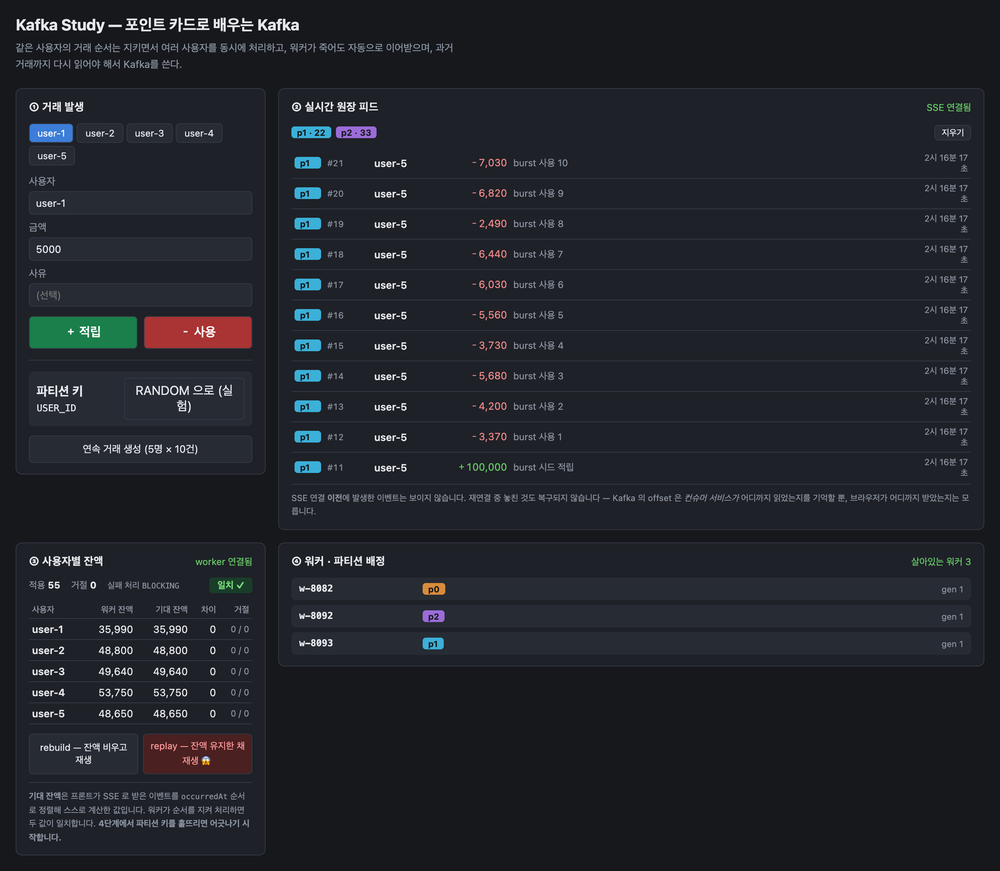
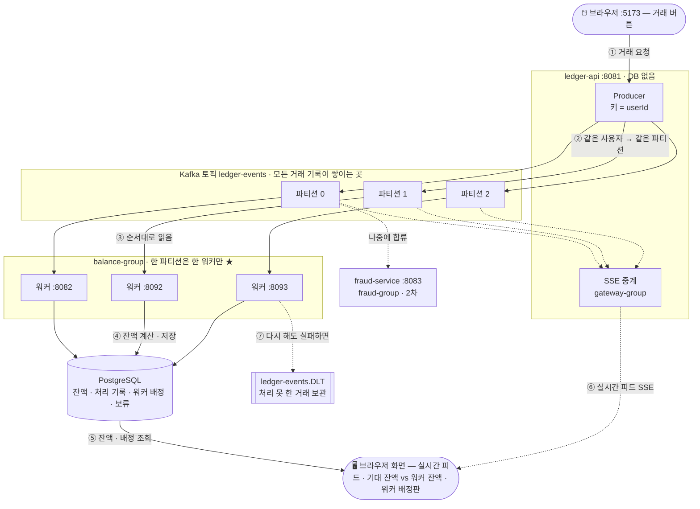
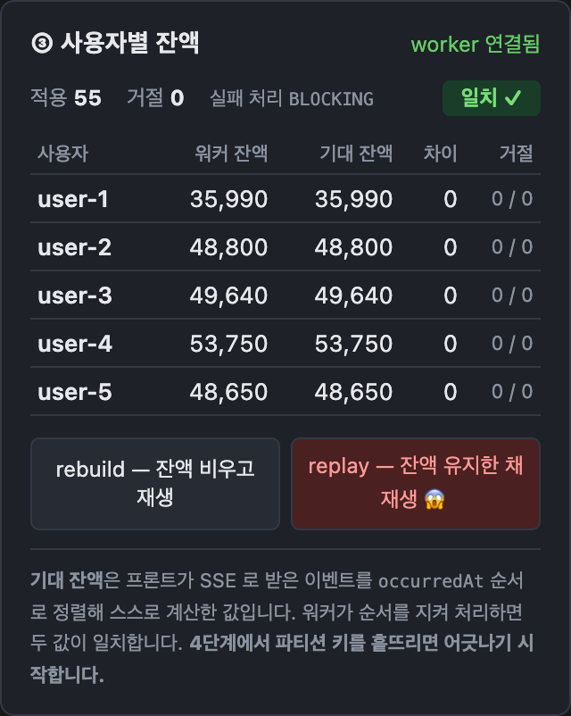
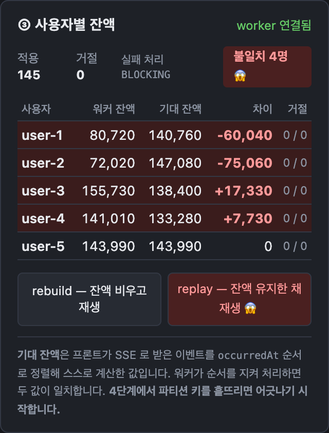
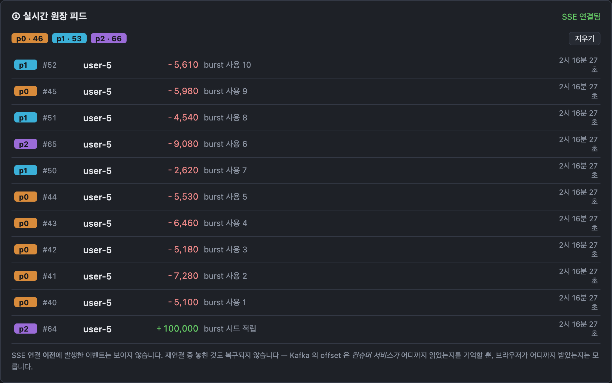
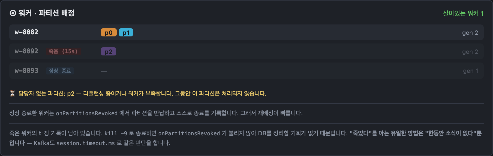
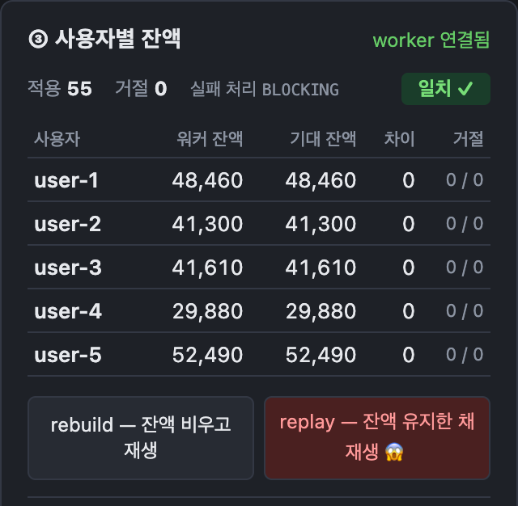
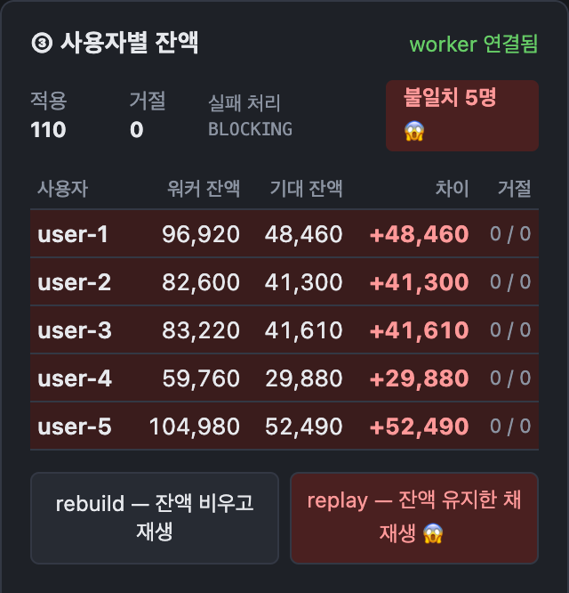
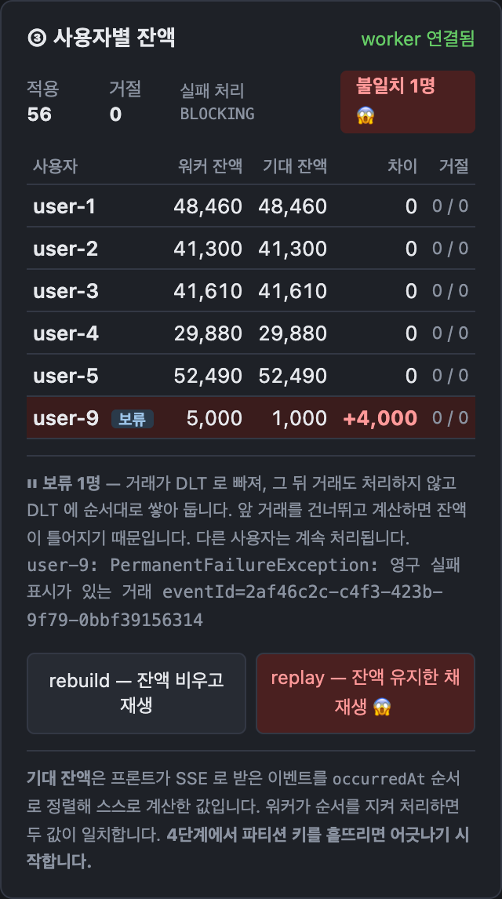

# Kafka Study — 포인트 카드로 배우는 Kafka

> **Kafka를 "눈으로 확인하며" 배우기 위해 만든 학습용 프로젝트입니다.**
> 실서비스가 아닙니다. 기능을 많이 만드는 것보다, Kafka의 핵심 동작을 **일부러 깨뜨려 보고 숫자로 확인하는 것**이 목적입니다.

| 기간 | |
|---|---|
| **시작** | 2026-09-05 |
| **1차 완결** (0~5단계, `step-5`) | 2026-09-06 |
| **재검증 · 문서 보강 · 실패 처리(7단계)** | 2026-10-20 ~ 2026-10-21 |

> 날짜는 git 커밋 기록 기준입니다.

> **바쁘시면 — 5분 코스**
> 1. 바로 아래 **"이게 뭐 하는 프로그램인가요?"** 와 **실제 화면** (1분)
> 2. **[4. 확인한 결과](#4-확인한-결과)** — 무엇을 깨뜨려 보고 무엇을 확인했나 (1분)
> 3. **[KS-20](docs/issues/KS-20-order-broken-experiment.md)** — 메시지 키 하나로 잔액이 틀어지는 하이라이트 (3분)
>
> 코드부터 보고 싶다면 → **[코드 지도](#코드-지도--어디부터-보나)**

---

## 이게 뭐 하는 프로그램인가요?

이 프로젝트는 **포인트 적립과 사용 내역을 기록하고, 각 사용자의 거래를 바탕으로 현재 잔액을 계산하는 프로그램**입니다.
카페에서 커피를 구매하면 포인트가 적립되고, 적립한 포인트로 결제하면 잔액이 줄어듭니다.
남은 포인트보다 많이 사용하려고 하면 잔액 부족으로 거래가 거절됩니다.

### 그런데 조금 특이하게 만들었습니다

보통은 "남은 포인트: 3,000" 이라는 숫자 하나를 고쳐 가며 관리합니다.
이 프로젝트는 **은행 통장처럼** 만들었습니다.

```
9/5  커피 적립   +5,000
9/5  케이크 결제 -3,000
9/6  커피 적립   +5,000
──────────────────────
남은 포인트       7,000   ← 내역을 위에서부터 더한 결과
```

**내역(기록)이 진짜**이고, 남은 포인트는 그 내역을 더해서 나온 결과일 뿐입니다.
이 "내역을 쌓아 두는 장부" 역할을 **Kafka** 라는 도구가 맡습니다.

### 그래서 무엇을 확인했나요?

거래가 많아지면 잔액을 계산하는 서버(워커)를 **여러 대** 둬야 합니다. 그러면 문제가 생길 수 있습니다.

| 생길 수 있는 문제 | 예시 | 확인한 것 |
|---|---|---|
| **순서가 꼬인다** | 적립보다 결제가 먼저 처리되어 "포인트 부족"으로 잘못 거절 | Kafka가 **한 사용자의 거래는 한 서버가 순서대로** 처리하게 해 주는지 |
| **서버가 갑자기 죽는다** | 계산하던 서버가 죽으면 그 서버가 맡던 사용자의 거래는? | 남은 서버가 **자동으로 이어받는지**, 그사이 내역이 사라지지 않는지 |
| **같은 내역을 두 번 계산한다** | 커피 적립을 두 번 더해 포인트가 두 배로 | 두 번 받아도 **한 번만 반영**되게 막을 수 있는지 |
| **계산하다 실패한다** | 잠깐 장애가 나거나, 아예 잘못된 내역이 들어오면? | 다시 시도할지, **따로 빼 둘지**, 그래도 **순서는 지켜지는지** |

이 문제들을 **일부러 일으켜 보고**, 화면에 숫자로 확인했습니다. 결과만 먼저 보고 싶다면 → [4. 확인한 결과](#4-확인한-결과)

### 실제 화면



| 영역 | 보이는 것 |
|---|---|
| ① 거래 발생 (왼쪽 위) | 적립 · 사용 버튼, 파티션 키 전환 버튼, 연속 거래 생성 버튼 |
| ② 실시간 원장 피드 (오른쪽 위) | 들어온 거래와, 그 거래가 들어간 파티션(p0 · p1 · p2) |
| ③ 사용자별 잔액 (왼쪽 아래) | **워커가 계산한 잔액 vs 화면이 직접 계산한 기대 잔액** — 둘이 같으면 "일치 ✓" |
| ④ 워커 · 파티션 배정 (오른쪽 아래) | 어떤 워커가 어떤 파티션을 맡고 있는지 |

---

## 30초 요약 (개발자용)

| | |
|---|---|
| **무엇을 만들었나** | 포인트 적립 · 사용 거래를 Kafka 에 기록하고, 여러 대의 계산 프로그램(워커)이 그 기록을 읽어 사람별 잔액을 계산하는 작은 시스템 |
| **왜 만들었나** | 실무에서는 메시지를 **저장하지 않는** Redis Pub/Sub만 써 봤다. 메시지 자체가 원본일 때 무엇이 필요한지 직접 확인하고 싶었다 |
| **무엇을 확인했나** | 순서 보장 · 병렬 처리 · 장애 시 자동 인수 · 다시 읽기(재생) · 중복 방지(멱등) · 실패 처리(재시도 · DLT) — 각각을 **깨뜨려 보고 고쳐서** 화면의 숫자로 확인 |
| **핵심 장면** | 메시지 키 한 줄을 바꾸자 **5명 전원의 잔액이 틀어졌다** |

## 한눈에 보는 전체 구조



| 번호 | 일어나는 일 |
|---|---|
| ① | 화면에서 적립 · 사용 버튼을 누르면 `ledger-api` 로 거래 요청이 간다 |
| ② | `ledger-api` 는 거래를 저장하지 않고 **Kafka 에 기록만** 한다. 키가 `userId` 라서 같은 사용자의 거래는 항상 같은 파티션으로 간다 |
| ③ | 워커들은 `balance-group` 으로 묶여 **파티션을 하나씩 나눠 맡는다.** 같은 사용자의 거래는 한 워커가 순서대로 읽는다 |
| ④ | 워커가 잔액을 계산해 PostgreSQL 에 저장한다 |
| ⑤ | 화면은 워커에게 잔액과 워커 배정 현황을 물어 표로 보여준다 |
| ⑥ | 동시에 `ledger-api` 의 중계 그룹이 모든 파티션을 읽어 화면에 **실시간 피드**로 흘려준다. 화면은 이걸로 "기대 잔액"을 직접 계산해 워커 잔액과 비교한다 |
| ⑦ | 워커가 어떤 거래를 다시 해도 처리하지 못하면 **DLT** 라는 별도 토픽으로 빼 두고, 그 사용자의 뒤 거래를 **보류**한다 (7단계) |

점선 중 피드 · 이상거래 탐지로 가는 것은 "같은 기록을 **다른 그룹이 따로** 읽는다"는 뜻입니다. 큐와 달리 Kafka 는 읽어도 지워지지 않아서, 중계 · 잔액 계산 · 이상거래 탐지(2차)가 같은 거래를 각자 읽을 수 있습니다.

| 서비스 | 역할 | 개수 |
|---|---|---|
| `ledger-api` | 거래를 Kafka에 발행하고, 전체 이벤트를 화면에 실시간 중계(SSE). **DB 없음** | 1개 |
| `balance-worker` | Kafka를 읽어 사용자별 잔액을 계산해 DB에 저장 | **여러 개 ★** — 순서 · 병렬 · 장애 · 실패 실험의 중심 |
| `fraud-service` | 거래가 쌓인 뒤 나중에 합류하는 이상거래 탐지 서비스 | 뼈대만 있음 (2차 과제) |

**화면은 두 잔액을 나란히 보여줍니다.**

- **기대 잔액** — 브라우저가 받은 이벤트를 발생 시각 순으로 직접 더한 값 (정답)
- **워커 잔액** — 워커가 Kafka를 읽어 계산해 DB에 저장한 값

**둘이 어긋나면 어딘가에서 순서가 깨졌거나 거래가 빠졌다는 뜻입니다.** 이 대조로 결과가 맞는지 확인합니다.

더 자세히 → [02. 설계서](docs/planning/02-architecture.md) — 흐름 시퀀스, 이벤트 스키마, API, DB 테이블

---

## 1. 왜 만들었나 — 흘려보내는 메시지에서, 저장하는 메시지로

실무에서는 Redis Pub/Sub 으로 **"새 주문이 들어왔어요" 알림**을 매장 화면에 보내는 기능을 만들었습니다.
Redis Pub/Sub 은 알림을 **저장하지 않습니다.** 받는 쪽이 잠깐 연결이 끊겨 있으면 그 알림은 그냥 사라집니다.

그래도 괜찮았던 이유는 **진짜 주문 정보는 DB에 따로 저장돼 있었기 때문**입니다. 알림을 놓쳐도 화면이 DB를 다시 조회하면 됐습니다.

| | 실무 (Redis Pub/Sub) | 이 프로젝트 (Kafka) |
|---|---|---|
| 메시지의 성격 | **알림** — "화면을 새로 고쳐라" | **기록** — "user-1이 5,000P를 적립했다" |
| 진짜 정보가 있는 곳 | DB | **Kafka 에 쌓인 기록 자체** (잔액은 기록을 더한 결과) |
| 메시지를 놓치면 | DB를 다시 조회하면 됨 | **되찾을 곳이 없다** |
| 두 번 받으면 | 화면을 한 번 더 그릴 뿐 | **포인트가 두 배가 된다** |

> **메시지 자체가 유일한 기록이라면, 무엇을 지켜야 하는가?**
> 이 질문에 코드로 답해 보려고 만든 프로젝트입니다.

큐를 쓰는 이유와 대가, 전달 보장, 재시도 · DLQ는 → [07. 메시지 큐](docs/planning/07-message-queue.md)

---

## 2. 왜 하필 포인트인가

**처리 순서가 바뀌면 결과가 달라지는 일**이어야 Kafka 의 순서 보장이 진짜로 필요해지기 때문입니다.

```
잔액 1,000원에서   ① 5,000원 적립   ② 3,000원 사용

①→② 순서:  1,000 → 6,000 → 3,000              ✅ 정상
②→① 순서:  1,000 → [잔액 부족, 거절] → 6,000    ❌ 결과가 다르다
```

같은 거래 두 건인데 처리 순서만 바뀌어도 잔액이 달라집니다. 그리고 그 차이가 **화면에 숫자로** 보입니다.

---

## 3. 기초 개념

| 용어 | 한 줄 설명 | 이 프로젝트에서 |
|---|---|---|
| **토픽** | 메시지가 쌓이는 이름 붙은 로그. 읽어도 지워지지 않는다 | `ledger-events` 하나 |
| **파티션** | 토픽을 나눈 칸. **순서는 한 파티션 안에서만** 지켜진다 | 3개 |
| **메시지 키** | 어느 파티션에 넣을지 정하는 값. 같은 키 → 같은 파티션 | `userId` — 같은 사용자의 거래는 같은 칸으로 |
| **컨슈머 그룹** | 파티션을 나눠 맡는 소비자 묶음. 한 파티션은 그룹 안의 한 명만 읽는다 | 잔액 워커 여러 개가 `balance-group` 하나로 묶인다 |
| **offset** | 그룹이 각 파티션에서 어디까지 읽었는지. 되돌리면 **다시 읽을 수 있다** | 재생(rebuild / replay)의 원리 |
| **DLT** (Dead Letter Topic) | 다시 해도 처리하지 못한 메시지를 빼 두는 별도 토픽. 큐에서는 DLQ 라고 부른다 | `ledger-events.DLT` — 실패한 거래를 원인과 함께 보관 |

토픽부터 offset 까지 다섯 개가 합쳐지면 **"같은 사용자의 거래는 한 워커가 순서대로, 다른 사용자들은 여러 워커가 동시에"** 가 됩니다.
DLT 는 그 순서를 지키면서 실패한 거래를 어떻게 다룰지(7단계)에 쓰입니다.

더 자세히 → [02. 설계서 6번 — 토픽 설계 · 파티션 키](docs/planning/02-architecture.md#6-토픽-설계) · [07. 메시지 큐 — Pub/Sub · 큐 · 로그의 차이](docs/planning/07-message-queue.md)

---

## 4. 확인한 결과

| # | 확인하고 싶었던 것 | Kafka 메커니즘 | 결과 | 실험 |
|---|---|---|---|---|
| 1 | 같은 사용자의 거래는 순서대로 | 파티션 키 | 키를 흩뜨리자 **5명 전원 불일치**, `userId` 키에서는 **차이 0** | A |
| 2 | 워커를 늘려 병렬 처리 | 컨슈머 그룹 | 워커 3개 → 파티션 1개씩. 4개 → **1개는 논다** (파티션 수가 상한) | - |
| 3 | 워커가 죽어도 자동 인수 | 리밸런싱 | 정상 종료 **8초**, 강제 종료 **47초**. 발행 135건 = 처리 135건 | B |
| 4 | 전체를 다시 읽어 재구축 | offset 되감기 | 멱등 없이 재생 → **정확히 2배**, 비우고 재생 → 정확히 복원, 멱등 켜고 재생 → **전부 건너뜀** | C |
| 5 | 새 서비스가 나중에 합류 | 그룹별 독립 offset | 2차 과제 | D |
| 6 | 처리에 실패해도 잔액이 틀어지지 않음 | 재시도 · DLT | 기본값은 **조용히 버려 불일치**, 재시도 토픽은 **순서가 깨져 불일치**, 그 자리 재시도 + DLT + 보류는 **일치** — 대가로 같은 파티션의 다른 사용자가 **22초** 대기 | E · F |

실패 처리를 아무것도 설정하지 않으면 워커가 멈출 줄 알았는데, Spring Kafka 기본값은 **10번 다시 하고 조용히 건너뛰었습니다.**
멈추면 누군가 알아채지만, 조용히 건너뛰면 **틀린 잔액이 정상처럼** 보입니다. → [KS-35](docs/issues/KS-35-failure-handling.md)

전체 회고 → [06. 진행 기록](docs/planning/06-progress.md) · 아래 6번에서 직접 따라 해 볼 수 있습니다.

---

## 5. 직접 실행해 보기 (약 10분)

### 준비물

| 도구 | 버전 | 비고 |
|---|---|---|
| Docker Desktop | Compose v2 포함 | Kafka · PostgreSQL · Kafka UI를 띄운다 |
| JDK | 17 이상 (21도 됨) | 빌드는 JDK 17로 고정되어 있는데, **17이 없으면 첫 빌드 때 Gradle이 자동으로 내려받습니다** |
| Node.js | 20 이상 | 화면(Vue) 실행용 |

### ① 인프라 띄우기

```bash
docker compose -f docker/docker-compose.yml up -d --wait
```

Kafka(`:9092`), PostgreSQL(`:5432`), Kafka UI(<http://localhost:8090>)가 뜹니다.
DB(`balancedb`, `frauddb`)는 자동으로 만들어집니다.

### ② 토픽 만들기 (파티션 3개)

```bash
docker exec kafka /opt/kafka/bin/kafka-topics.sh --bootstrap-server localhost:9092 --create --topic ledger-events --partitions 3 --replication-factor 1
```

> 토픽 자동 생성을 **일부러 꺼 두었습니다.** 파티션 수를 직접 정하는 것이 이 프로젝트의 학습 포인트이기 때문입니다.
> `docker/cli-lab.sh`는 CLI 실습용 스크립트입니다. 이 스크립트가 넣는 JSON은 앱이 읽지 못하는 **깨진 메시지**입니다.
> 지금은 워커가 멈추지 않고 건너뛰거나(`DEFAULT`) DLT 로 빼지만(`BLOCKING`) — [KS-35](docs/issues/KS-35-failure-handling.md),
> 예전에는 워커를 무한히 멈추게 했습니다([TS-2](docs/troubleshooting/TS-2-poison-pill.md)). 실험 결과가 섞이므로 앱을 돌릴 토픽에는 실행하지 마세요.

### ③ 백엔드 빌드 — 한 번만

```bash
cd backend && ./gradlew build
```

처음이면 의존성과 (없을 경우) JDK 17을 내려받느라 몇 분 걸립니다. `BUILD SUCCESSFUL`이 나오면 다음으로 넘어가세요.

> **이 단계를 건너뛰지 마세요.** 빌드 없이 아래 터미널 4개를 한꺼번에 띄우면
> Gradle 4개가 같은 빌드 폴더를 동시에 컴파일하다 서로 충돌해 일부가 `BUILD FAILED`로 죽습니다.

### ④ 백엔드 띄우기 — 터미널 4개

```bash
cd backend && ./gradlew :ledger-api:bootRun
```

```bash
cd backend && SERVER_PORT=8082 ./gradlew :balance-worker:bootRun
```

```bash
cd backend && SERVER_PORT=8092 ./gradlew :balance-worker:bootRun
```

```bash
cd backend && SERVER_PORT=8093 ./gradlew :balance-worker:bootRun
```

워커 3개가 같은 컨슈머 그룹으로 묶여 **파티션을 하나씩 나눠 맡습니다.**
화면은 `:8082` 워커에서 잔액을 조회하므로 `:8082`는 꼭 띄워 주세요.

### ⑤ 화면 띄우기

```bash
cd frontend && npm install && npm run dev
```

<http://localhost:5173> 을 엽니다.

| 영역 | 보이는 것 |
|---|---|
| ① 거래 발생 | 적립 · 사용 버튼, **파티션 키 전환 버튼**, 연속 거래 생성 버튼 |
| ② 실시간 원장 피드 | 들어온 거래 내역이 실시간으로 쌓인다. 각 거래가 **어느 파티션(p0 · p1 · p2)** 에 들어갔는지 색으로 표시 |
| ③ 사용자별 잔액 | **워커 잔액 vs 기대 잔액**, 차이, 일치 · 불일치 판정, rebuild · replay 버튼, 실패 처리 모드와 **"보류"** 된 사용자 |
| ④ 워커 · 파티션 배정 | 어떤 워커가 어떤 파티션을 맡고 있는지 실시간 표시 |

> 브라우저는 **거래를 발생시키기 전에** 열어 두세요. 기대 잔액은 브라우저가 받은 이벤트로만 계산합니다.

### 처음부터 다시 하고 싶을 때

```bash
docker compose -f docker/docker-compose.yml down -v
```

Kafka와 DB 데이터가 모두 지워집니다. 백엔드를 끄고 실행한 뒤 ①부터 다시 시작하세요.

막혔다면 → [트러블슈팅](docs/troubleshooting/) · [02. 설계서 5번 — 인프라 구성](docs/planning/02-architecture.md#5-인프라-구성)

---

## 6. 실험 따라 하기

### 실험 A ★ — 순서가 깨지면 잔액이 틀어진다

| 순서 | 할 일 | 보이는 것 |
|---|---|---|
| 1 | 워커 3개가 떠 있는 상태에서 **[연속 거래 생성]** | ③에 **"일치 ✓"** — 워커가 3개여도 잔액이 맞는다 |
| 2 | **[RANDOM 으로 (실험)]** 클릭 | 파티션 키가 `userId` 대신 무작위 값으로 바뀐다 |
| 3 | **[연속 거래 생성]** 을 한두 번 | ②에서 같은 사용자의 거래가 여러 파티션 색으로 흩어지고, ③에 **"불일치 N명 😱"** |

**바꾼 것은 메시지 키 하나뿐입니다.** 같은 사용자의 거래가 여러 파티션에 흩어지면 서로 다른 워커가 동시에 처리합니다.
그러면 "사용"이 "적립"보다 먼저 처리되어 **잘못 거절되거나**, 두 워커가 같은 잔액을 동시에 고쳐 **한쪽 갱신이 사라집니다.**

> **주의 — 키를 되돌려도 이미 흩어진 기록은 고쳐지지 않습니다.**
> RANDOM 모드로 발행된 거래는 이미 여러 파티션에 나뉘어 **로그에 영구히** 남았습니다.
> 키를 `USER_ID`로 되돌리고 rebuild 해도 그 거래들의 순서는 돌아오지 않습니다.
> 다시 일치하는 화면을 보려면 **"처음부터 다시 하고 싶을 때"** 로 초기화한 뒤 `USER_ID` 모드로 발행하세요.
> 로그가 원본이라는 말은, **잘못 기록된 것도 원본으로 남는다**는 뜻이기도 합니다.

자세한 결과 → [KS-20](docs/issues/KS-20-order-broken-experiment.md)

<table>
<tr><th>키 = userId — 워커 3개여도 일치</th><th>키 = RANDOM — 같은 워커 3개, 불일치</th></tr>
<tr><td></td>
<td></td></tr>
</table>

키를 RANDOM 으로 바꾸면 같은 사용자의 거래가 **p0 · p1 · p2 여러 파티션으로 흩어집니다** (아래 피드의 색).



> 순서가 꼬이는 정도는 타이밍에 따라 달라서, 실행할 때마다 어긋나는 사용자 수와 금액이 조금씩 다릅니다.

### 실험 B — 워커가 죽어도 남은 워커가 이어받는다

| 순서 | 할 일 | 보이는 것 |
|---|---|---|
| 1 | `:8093` 워커를 정상 종료 — 터미널에서 `Ctrl+C` | ④에서 몇 초 안에 그 워커의 파티션이 다른 워커로 넘어가고, 그 워커는 **"정상 종료"** 로 표시된다 |
| 2 | 다시 띄운다 | 파티션이 다시 나뉜다 (리밸런싱) |
| 3 | 이번엔 강제 종료 — `kill -9 $(lsof -t -iTCP:8093 -sTCP:LISTEN)` | 재배정까지 **약 45초**, 그 워커는 **"죽음"** 으로 표시된다 — 죽었다고 알릴 기회가 없어서, 브로커가 응답이 끊긴 것을 기다려야 한다 (`session.timeout.ms` 기본값 45초) |

그동안 거래를 계속 발생시켜도 **유실도 중복도 없습니다.** → [KS-21](docs/issues/KS-21-rebalance-experiment.md)



정상 종료한 워커(w-8093)는 바로 **"정상 종료"** 로 표시되고 파티션을 넘깁니다.
강제 종료한 워커(w-8092)는 **"죽음"** 으로 표시되고, 그 파티션(p2)은 약 45초 동안 **담당자 없이** 남습니다.

### 실험 C — 다시 읽으면 포인트가 두 배가 된다

`rebuild`는 **요청을 받은 워커가 맡은 파티션만** 되감습니다. 이 실험은 **워커를 1개(`:8082`)만** 띄워 둔 상태에서 하세요.

| 순서 | 할 일 | 보이는 것 |
|---|---|---|
| 1 | 거래를 몇 건 발생 | 잔액 확인 |
| 2 | **[replay — 잔액 유지한 채 재생]** | 잔액이 **정확히 2배** — 같은 거래를 한 번 더 적용했다 |
| 3 | **[rebuild — 잔액 비우고 재생]** | 원래 잔액으로 **정확히 복원** — 로그가 원본이라 언제든 다시 계산할 수 있다 |
| 4 | 워커를 `cd backend && APP_IDEMPOTENT=true SERVER_PORT=8082 ./gradlew :balance-worker:bootRun` 으로 재기동한 뒤 rebuild → replay | replay 해도 **잔액 불변** — 이미 처리한 `eventId`는 건너뛴다 (멱등) |

멱등 처리는 기본값이 **꺼져 있습니다.** 두 배가 되는 문제를 먼저 겪어 보라는 의도입니다. → [KS-23](docs/issues/KS-23-idempotency-experiment.md)

> 실험 D(이상거래 탐지 서비스가 나중에 합류)는 2차 과제라 아직 없습니다. 실험 이름은 [01. 기획서 7번](docs/planning/01-planning.md#7-눈으로-확인하는-실험)과 같습니다.

<table>
<tr><th>replay 전 — 일치</th><th>replay 후 — 워커 잔액이 정확히 2배</th></tr>
<tr><td></td>
<td></td></tr>
</table>

### 실험 E · F — 처리에 실패하면 어떻게 되나 (재시도 · DLT)

거래의 **사유 칸**에 아래 표시를 넣으면 워커가 그 거래를 처리하다 일부러 실패합니다.

| 사유 칸에 입력 | 동작 | 흉내 내는 상황 |
|---|---|---|
| `[실험] 일시 실패 5초` | 거래 발생 후 5초 동안만 실패 (숫자는 바꿀 수 있다) | DB · 외부 API 가 잠깐 응답하지 않음 |
| `[실험] 영구 실패` | 몇 번을 다시 해도 실패 | 잘못된 데이터 |

워커를 띄울 때 **실패 처리 방식**(`APP_ERROR_MODE`)을 고릅니다. 화면 ③ 위쪽에 지금 방식이 표시됩니다.

```bash
cd backend && APP_ERROR_MODE=BLOCKING SERVER_PORT=8082 ./gradlew :balance-worker:bootRun
```

> **방식을 바꾸려면 떠 있는 워커를 모두 끄고 같은 값으로 다시 띄우세요.** 워커마다 방식이 다르면 어느 파티션이 어떻게 처리될지 알 수 없습니다.
> 실험마다 결과가 섞이지 않게, 방식을 바꿀 때는 [처음부터 다시 하고 싶을 때](#처음부터-다시-하고-싶을-때)로 초기화하는 것을 권합니다.

| `APP_ERROR_MODE` | 동작 | 해 볼 것 (한 사용자에게 차례로) | 보이는 것 |
|---|---|---|---|
| `DEFAULT` (기본) | Spring 기본값 — 즉시 10번 다시 하고 **조용히 건너뛴다** | 5,000 적립 → `[실험] 영구 실패` 로 3,000 사용 → 1,000 사용 | 실패한 거래가 사라져 **불일치** (워커 4,000 / 기대 1,000) |
| `NON_BLOCKING` | 재시도 토픽 — 실패한 거래를 **뒤로 미루고** 다음 거래부터 처리 | 5,000 적립 → `[실험] 일시 실패 5초` 로 3,000 사용 → 4,000 사용 | 4,000 이 먼저 처리돼 **순서가 깨지고 불일치** — **실험 E** |
| `BLOCKING` | 그 자리에서 2초 간격으로 다시 시도. 영구 실패면 **DLT** 로 빼고 그 사용자를 **보류** | ① `NON_BLOCKING` 과 같은 순서 ② `[실험] 영구 실패` | ① 순서대로 처리돼 **일치** ✅ ② 그 사용자 옆에 **"보류"**, 뒤 거래도 DLT 로 |

**실험 F — 순서를 지키는 대가.** 워커 3개를 모두 `BLOCKING` 으로 띄우고 한 사용자에게 `[실험] 일시 실패 20초` 를 넣은 뒤 바로 다른 사용자들의 거래를 발생시키세요.
**같은 파티션에 있는 다른 사용자도 20초 동안 기다립니다.** 다른 파티션의 사용자는 바로 처리됩니다. (어느 사용자가 같은 파티션인지는 ② 피드의 색으로 보입니다.)

DLT 에 쌓인 거래는 Kafka UI(<http://localhost:8090>)의 `ledger-events.DLT` 토픽에서 원인 헤더와 함께 볼 수 있습니다.

> `NON_BLOCKING` 에서는 rebuild · replay 를 막아 두었습니다. 재시도 토픽을 읽는 컨슈머까지 되감기에 섞이기 때문입니다.
> rebuild 는 잔액과 함께 보류도 비웁니다. 처음부터 다시 읽으면 실패할 거래는 다시 실패해 다시 보류됩니다.

자세한 결과 → [KS-35](docs/issues/KS-35-failure-handling.md)



`BLOCKING` 에서 `[실험] 영구 실패` 거래를 넣은 화면입니다. `user-9` 옆에 **"보류"** 가 붙고, 그 뒤 거래도 DLT 로 가서 잔액에 반영되지 않습니다.
기대 잔액과 다른 것은 **의도한 차이**입니다 — 실패한 거래를 건너뛰고 계산하는 대신, 원인을 해결할 때까지 그 사용자만 멈춘 상태입니다.
다른 사용자들은 계속 일치합니다.

---

## 7. 이 프로젝트가 주장하지 않는 것

**"Kafka가 아니면 불가능하다"고 주장하지 않습니다.** DB 테이블로도 만들 수 있습니다.
다만 그러려면 워커 관리 · 장애 감지 · 작업 재분배 · 읽은 위치 기록 · 중복 처리 방지를 **전부 직접 만들어야** 합니다.

> **DB를 쓰면 이 기능들을 직접 만들어야 하는데, Kafka는 메시징 시스템 자체에서 제공한다.**

그리고 **Kafka가 필요 없는 경우**도 분명히 있습니다.

| 상황 | 더 맞는 선택 |
|---|---|
| 원본이 DB에 있고 화면 갱신 알림만 필요 | Redis Pub/Sub |
| 순서가 중요하지 않은 작업 분배 | SQS · RabbitMQ · DB 큐 |
| 규모가 작고 소비자가 하나 | DB 테이블 큐 — Kafka는 과하다 |

다른 도구와의 비교:

| | 순서 + 병렬 + 장애 인수 | 재생 | 독립 소비자 |
|---|---|---|---|
| DB 테이블 큐 | △ 직접 만들면 가능 | ✅ | △ 직접 관리 |
| RabbitMQ | ❌ | ❌ 소비하면 삭제 | ✅ |
| Redis Streams | ❌ 파티션 개념 없음 | ✅ | ✅ |
| SQS FIFO | ✅ | ❌ 소비하면 삭제 | ❌ |
| AWS Kinesis | ✅ | ✅ | ✅ |
| Kafka | ✅ | ✅ | ✅ |

셋을 다 하는 것은 Kafka와 Kinesis입니다. 처음엔 "Kafka뿐"이라고 썼다가 Kinesis를 빠뜨린 과장임을 알고 고쳤습니다.
→ [01. 기획서](docs/planning/01-planning.md) · [05. DB로 직접 만들면](docs/planning/05-why-not-diy.md)

---

## 8. 문서 읽는 순서

모든 기획 · 결정 · 실험 결과 · 트러블슈팅은 [`docs/`](docs/README.md)에 티켓 단위(`KS-N`)로 남겼습니다.
**각 티켓의 "배운 것" 섹션에 이 프로젝트에서 배운 내용이 모여 있습니다.**

| 시간이 있다면 | 문서 | 내용 |
|---|---|---|
| 5분 | [KS-20](docs/issues/KS-20-order-broken-experiment.md) | 하이라이트 — 순서가 깨지는 장면 |
| 5분 | [KS-35](docs/issues/KS-35-failure-handling.md) | 두 번째 하이라이트 — 권장 패턴(재시도 토픽)이 잔액을 깨뜨리는 장면, 순서를 지키는 대가 |
| 10분 | [06. 진행 기록](docs/planning/06-progress.md) | 무엇을 확인했고, 무엇이 틀렸다가 고쳐졌나 |
| 10분 | [07. 메시지 큐](docs/planning/07-message-queue.md) | 큐를 쓰는 이유와 대가, 재시도 · DLQ |
| 15분 | [01. 기획서](docs/planning/01-planning.md) | 요구사항, 주장의 강도, 도구 비교 |
| 10분 | [05. DB로 직접 만들면](docs/planning/05-why-not-diy.md) | split-brain, fencing token |
| 10분 | [KS-13](docs/issues/KS-13-pivot-ledger.md) | 처음 고른 주제 두 개가 무너지고 포인트로 바뀐 과정 |

<details>
<summary>전체 문서 목록</summary>

| 문서 | 내용 |
|---|---|
| [문서 인덱스 · 티켓 보드](docs/README.md) | 전체 문서 목록과 `KS-N` 티켓 현황 |
| [01. 기획서](docs/planning/01-planning.md) | 주장 강도, 도메인, 요구사항, 도구 비교, 실험 A~F |
| [02. 설계서](docs/planning/02-architecture.md) | 아키텍처, 흐름 시퀀스, 토픽 · 스키마 · API |
| [03. 기술 스택 결정서](docs/planning/03-tech-stack.md) | 스택 선택 근거, 탈락한 대안들 |
| [04. 작업 로드맵](docs/planning/04-roadmap.md) | 단계별 세부 작업 분해 |
| [05. DB로 직접 만들면](docs/planning/05-why-not-diy.md) | DIY 대응표, split-brain, fencing |
| [06. 진행 기록](docs/planning/06-progress.md) | 1차 완결 회고, 이후 재검증과 7단계 결과 |
| [07. 메시지 큐](docs/planning/07-message-queue.md) | 출발점, 큐를 쓰는 이유와 대가, 전달 보장, 재시도 · DLQ, 분산 트랜잭션 |
| 트러블슈팅 | [TS-1 advertised.listeners](docs/troubleshooting/TS-1-advertised-listeners.md) · [TS-2 poison pill](docs/troubleshooting/TS-2-poison-pill.md) · [TS-3 seek 콜백](docs/troubleshooting/TS-3-seek-callback.md) |

</details>

---

## 코드 지도 — 어디부터 보나

핵심 동작이 어느 파일에 있는지입니다. 각 파일 맨 위 주석에 **왜 그렇게 만들었는지**를 적어 두었습니다.

| 보고 싶은 것 | 파일 | 볼 곳 |
|---|---|---|
| 메시지 형식 — 키는 `userId`, 잔액은 담지 않는다 | [`LedgerEvent.kt`](backend/common/src/main/kotlin/com/ytw/kafkastudy/common/LedgerEvent.kt) | 맨 위 주석 "설계 전제" |
| 발행 — 키 고르기(`USER_ID` / `RANDOM`) | [`LedgerEventPublisher.kt`](backend/ledger-api/src/main/kotlin/com/ytw/kafkastudy/ledgerapi/publish/LedgerEventPublisher.kt) · [`PartitionKeyMode.kt`](backend/ledger-api/src/main/kotlin/com/ytw/kafkastudy/ledgerapi/config/PartitionKeyMode.kt) | `publish()` · `acks=all` 은 [`application.yml`](backend/ledger-api/src/main/resources/application.yml) |
| 소비 — 한 파티션은 한 워커만, 그래서 락이 없다 | [`LedgerConsumer.kt`](backend/balance-worker/src/main/kotlin/com/ytw/kafkastudy/balanceworker/consume/LedgerConsumer.kt) | 클래스 주석, `consume()` |
| 잔액 계산 — 순서가 결과를 바꾸는 지점, 멱등 처리 | [`BalanceService.kt`](backend/balance-worker/src/main/kotlin/com/ytw/kafkastudy/balanceworker/domain/BalanceService.kt) | `apply()` — 잔액 부족 거절, `eventId` 처리 기록 |
| 재생 — offset 되감기, 스레드를 넘지 않는 seek | [`ReplayController.kt`](backend/balance-worker/src/main/kotlin/com/ytw/kafkastudy/balanceworker/consume/ReplayController.kt) (`ReplayCoordinator`) · [`BalanceController.kt`](backend/balance-worker/src/main/kotlin/com/ytw/kafkastudy/balanceworker/web/BalanceController.kt) | `seekToBeginning()`, `rebuild` · `replay` |
| 리밸런싱 관찰 — 파티션 배정 · 하트비트 · 정상 종료 | [`AssignmentTracker.kt`](backend/balance-worker/src/main/kotlin/com/ytw/kafkastudy/balanceworker/consume/AssignmentTracker.kt) | `onPartitionsAssigned` · `onPartitionsRevokedBeforeCommit` · `markStopped` |
| 실패 처리 — 세 가지 방식, DLT, 사용자 보류 | [`ErrorHandlingConfig.kt`](backend/balance-worker/src/main/kotlin/com/ytw/kafkastudy/balanceworker/config/ErrorHandlingConfig.kt) · [`QuarantineService.kt`](backend/balance-worker/src/main/kotlin/com/ytw/kafkastudy/balanceworker/domain/QuarantineService.kt) | `ErrorMode` 주석의 비교표 |
| 실험용 실패 장치 | [`FaultInjector.kt`](backend/balance-worker/src/main/kotlin/com/ytw/kafkastudy/balanceworker/consume/FaultInjector.kt) | 사유 칸 표시 → 예외 |
| 실시간 중계(SSE) | [`LedgerStreamGateway.kt`](backend/ledger-api/src/main/kotlin/com/ytw/kafkastudy/ledgerapi/stream/LedgerStreamGateway.kt) | `relay()` — `gateway-group` 으로 받아 연결된 화면 전부에 전달 |
| 화면의 기대 잔액 — 비교 기준 | [`ledger.ts`](frontend/src/stores/ledger.ts) | `expectedBalances`, `missedPartitions` |

테스트: [`BalanceServiceTest.kt`](backend/balance-worker/src/test/kotlin/com/ytw/kafkastudy/balanceworker/BalanceServiceTest.kt) (순서 · 멱등) · [`FaultInjectorTest.kt`](backend/balance-worker/src/test/kotlin/com/ytw/kafkastudy/balanceworker/FaultInjectorTest.kt) (실패 장치) · [`LedgerEventSerdeTest.kt`](backend/common/src/test/kotlin/com/ytw/kafkastudy/common/LedgerEventSerdeTest.kt) (직렬화)

---

## 9. 진행 상황

| 단계 | 내용 | 상태 |
|---|---|---|
| 0 | Kafka 인프라 + CLI 실습 | ✅ `step-0` |
| 1 | Gradle 멀티모듈 + PostgreSQL | ✅ `step-1` |
| 2 | `ledger-api` 발행 + 실시간 피드 | ✅ `step-2` |
| 3 | `balance-worker` 잔액 계산 | ✅ `step-3` |
| **4 ★** | **순서 깨짐 → 파티션 키 → 리밸런싱** | ✅ `step-4` |
| **5 ★** | **기록을 처음부터 다시 계산하기 & 중복 방지** | ✅ `step-5` — 1차 완결 |
| 6 | `fraud-service` 나중에 합류 | 2차 |
| 7 | 실패 처리 — 재시도, DLT, 사용자 보류, 깨진 메시지 격리 | ✅ `step-7` — [KS-35](docs/issues/KS-35-failure-handling.md) |
| - | 처리량 실험 — 워커 · 파티션 · 배치, 느린 처리가 일으키는 리밸런싱 | 대기 → [KS-29](docs/issues/KS-29-throughput-experiment.md) |

단계별 작업 분해 → [04. 작업 로드맵](docs/planning/04-roadmap.md) · 1차 이후 고친 것 → [06. 진행 기록 9번](docs/planning/06-progress.md#9-1차-완결-이후--다시-검증하며-고친-것)

`main` 에 머지한 단계마다 태그를 붙여 두었습니다(`step-0` ~ `step-5`, `step-7`). 6단계는 아직 하지 않아 `step-6` 은 없습니다. 특정 단계의 코드를 보고 싶다면:

```bash
git checkout step-4
```

---

## 기술 스택

| 영역 | 사용 기술 |
|---|---|
| 백엔드 | Kotlin · JDK 17 · Spring Boot 3.3 · Spring Kafka · Spring Data JPA · Gradle 멀티모듈 |
| 저장소 | Apache Kafka 3.9 (KRaft) · PostgreSQL 16 |
| 화면 | Vue 3 · Vite · Pinia · SSE |
| 인프라 | Docker Compose · Kafka UI |

## 작업 방식

Jira 대신 저장소 안의 문서로 작업을 관리했습니다.

- 작업 하나 = 티켓 문서 하나 (`docs/issues/KS-N-*.md`). **"배운 것"을 쓰지 않으면 티켓을 닫지 않는다**
- `main` ← `dev` ← `{타입}/KS-N-*` 브랜치. 학습 단계가 끝날 때마다 `main`에 태그(`step-N`)
- 문서는 코드와 같은 PR에. **무엇을 골랐는지보다 무엇을 왜 탈락시켰는지**를 남긴다

규칙: [문서 구조](docs/conventions/01-doc-structure.md) · [티켓 체계](docs/conventions/02-ticket.md) · [브랜치 전략](docs/conventions/03-branch-strategy.md)
