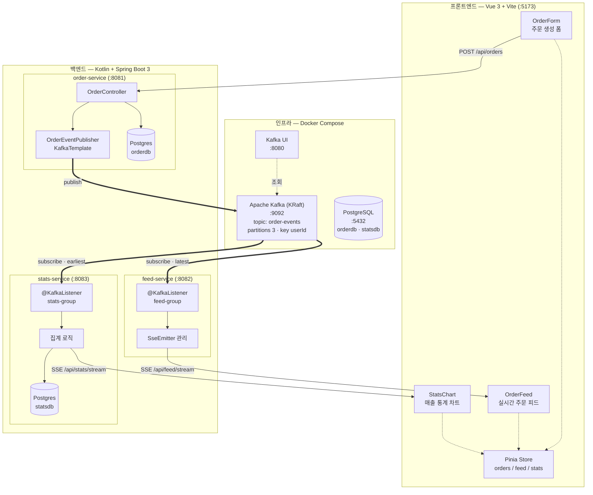
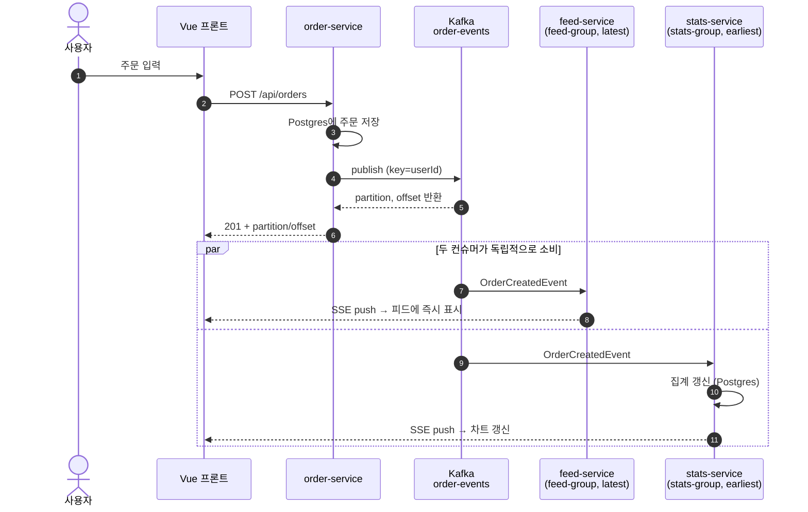
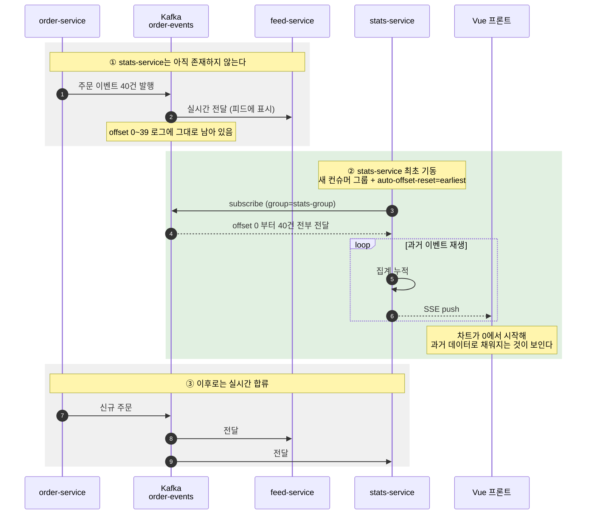
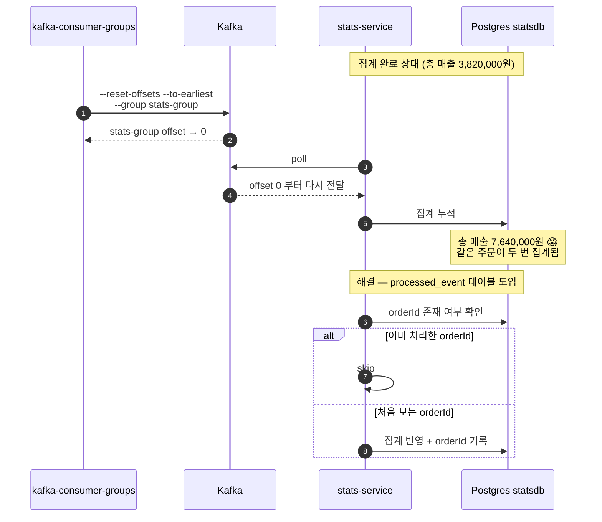
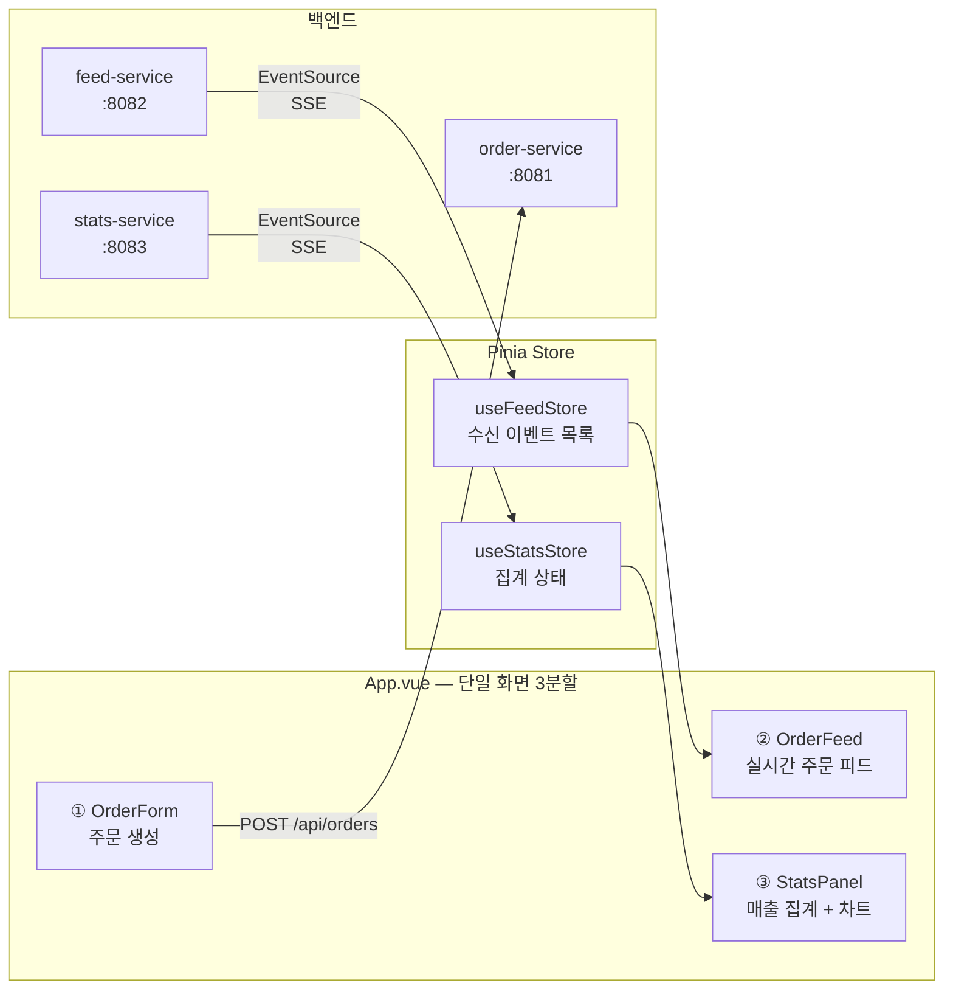
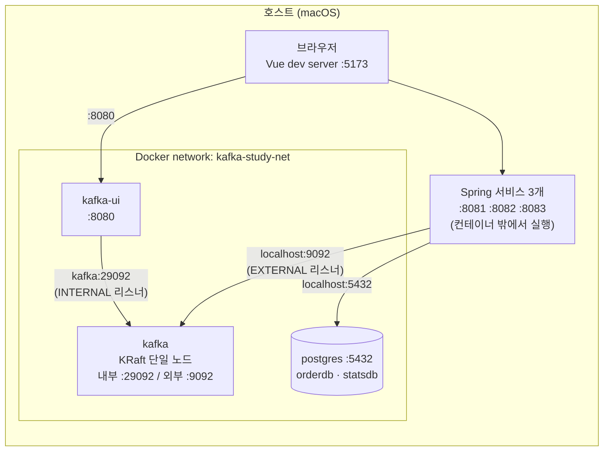

# 02. 설계서

## 1. 전체 아키텍처

프론트엔드부터 인프라까지 전체 계층.



### 계층별 역할 요약

| 계층 | 구성 | 역할 |
|---|---|---|
| **프론트엔드** | Vue 3 + Vite + Pinia + Chart.js | 주문 생성 트리거, 이벤트 흐름의 시각화 창 |
| **백엔드** | Kotlin + Spring Boot 3 × 3개 서비스 | Producer 1 + Consumer 2 |
| **인프라** | Kafka(KRaft) + Kafka UI + PostgreSQL, Docker Compose | 이벤트 로그 저장소 + 상태 저장소 + 관찰 도구 |

### 핵심 설계 포인트

**두 컨슈머는 서로 다른 컨슈머 그룹이다.**
같은 토픽을 각자의 offset으로 **독립적으로** 읽는다. 이것이 큐와 구조적으로 다른 지점이며, 3단계 하이라이트가 성립하는 이유다.

| 서비스 | 컨슈머 그룹 | `auto-offset-reset` | 의미 |
|---|---|---|---|
| feed-service | `feed-group` | `latest` | 기동 이후 들어온 주문만 본다 (실시간 피드니까) |
| stats-service | `stats-group` | `earliest` | **기동 시점에 쌓여 있던 과거 주문 전부를 읽는다** |

---

## 2. 서비스별 책임

### order-service (:8081) — Producer

- 주문 생성 요청을 받아 Postgres(`orderdb`)에 저장
- 저장된 주문을 `order-events` 토픽에 발행
- 파티션 키는 `userId` → **같은 사용자의 주문은 같은 파티션 = 순서 보장**

> DB 저장과 Kafka 발행 사이의 원자성 문제(트랜잭셔널 아웃박스 패턴)는 이 프로젝트 범위 밖. 학습 단계에서는 단순 발행으로 진행하되, 이 한계가 존재한다는 것은 인지한다.

### feed-service (:8082) — Consumer A, 실시간 피드

- `order-events`를 `latest`부터 구독
- 수신한 이벤트를 SSE로 연결된 브라우저에 즉시 push
- **상태를 저장하지 않는다** (순수 릴레이). DB도 메모리 버퍼도 두지 않는다
- SSE 연결 이전에 발생한 이벤트는 보이지 않는다 — 이것이 SSE의 특성이며, 과거를 보는 것은 `stats-service`의 역할이다
- 5단계에서 인스턴스를 여러 개 띄워 파티션 분배·리밸런싱을 관찰하는 대상

### stats-service (:8083) — Consumer B, 매출 집계

- `order-events` 구독. **최초 기동 시에만** `auto-offset-reset: earliest`가 발동해 전체를 읽고, 이후 재기동은 커밋된 offset에서 **이어서** 읽는다 (실무 정상 동작)
- 주문을 집계해 Postgres(`statsdb`)에 저장 (상품별 매출, 총 주문 수)
- 집계 결과를 REST로 조회 + 갱신 시 SSE로 push
- **명시적 재생 API**를 제공한다 (아래 8절 API 명세)
  - `POST /api/stats/rebuild` — 집계를 비우고 처음부터 다시 읽기 (3단계 데모 반복용)
  - `POST /api/stats/replay` — 집계를 **유지한 채** 처음부터 다시 읽기 (4단계 중복 재현용)
- 4단계에서 **처리한 `orderId`를 기록**해 중복 집계를 방지한다

---

## 3. 주요 흐름

### 3-1. 평상시 — 주문 생성부터 화면 반영까지



**핵심**: 두 컨슈머는 **서로 다른 컨슈머 그룹**이라 같은 메시지를 **둘 다** 받는다.
큐(RabbitMQ/SQS)였다면 둘 중 하나만 받는다. 이 그림이 이미 Kafka인 이유를 보여준다.

### 3-2. 하이라이트 — 뒤늦게 합류한 컨슈머의 과거 재생 (3단계)



**이것이 큐로 불가능한 이유**: ①에서 `feed-service`가 이미 소비한 메시지가 큐였다면 **사라진다.**
②에서 읽을 과거가 존재하지 않는다. Kafka는 소비해도 로그가 남기 때문에 성립한다.

### 3-3. Replay와 중복 집계 문제 (4단계)



> **3단계에서는 `processed_event` 테이블을 일부러 만들지 않는다.**
> 위 그림의 😱 상태를 직접 겪어봐야 멱등성의 필요성이 몸에 남는다.
> Kafka의 기본 전달 보장은 **at-least-once**이며, 이는 정상 운영 중 컨슈머 재시작·리밸런싱에서도 발생할 수 있는 일이다.

---

## 4. 프론트엔드 구조

프론트는 **Kafka의 흐름을 눈으로 보는 창**이다. 화면은 최소로 유지한다.

### 화면 구성



### 컴포넌트별 책임

| 컴포넌트 | 역할 | 학습상 의미 |
|---|---|---|
| `OrderForm` | userId·상품·수량·단가 입력 후 주문 생성 | **같은 userId로 반복 주문**해서 파티션 고정을 확인하는 도구 |
| `OrderFeed` | 수신 이벤트를 시간순 목록으로 표시. 각 행에 **partition / offset 뱃지** | 어느 파티션 몇 번 offset에 들어갔는지 눈으로 봄 |
| `StatsPanel` | 총 매출·주문 수 + 상품별 매출 차트 | **3단계에서 과거 재생으로 채워지는 과정**을 보는 무대 |

> `OrderFeed`의 partition/offset 뱃지는 실무에선 불필요하지만, 이 프로젝트에선 **파티션 개념을 화면에서 직접 체감하게 하는 핵심 장치**다. 같은 `userId`로 여러 건 주문하면 뱃지의 partition 번호가 고정되는 것이 보인다.

### 디렉토리 구조

```
frontend/
├── src/
│   ├── App.vue
│   ├── components/
│   │   ├── OrderForm.vue
│   │   ├── OrderFeed.vue
│   │   └── StatsPanel.vue
│   ├── stores/
│   │   ├── feed.ts
│   │   └── stats.ts
│   ├── composables/
│   │   └── useSse.ts        # EventSource 연결/해제/재연결 공통화
│   └── api/
│       └── order.ts
└── vite.config.ts           # dev 서버 프록시로 CORS 회피
```

### SSE 연결 관리

`useSse.ts` 컴포저블 하나로 두 SSE 채널(`feed`, `stats`)을 공통 처리한다.

- 컴포넌트 `onMounted`에 연결, `onUnmounted`에 `close()` — **해제를 빠뜨리면 연결이 누적된다**
- `EventSource`는 끊기면 브라우저가 자동 재연결하지만, **재연결 중 놓친 이벤트는 복구되지 않는다**

> 이 한계가 곧 [기획서](01-planning.md)에서 정리한 "Kafka는 SSE 연결 끊김을 해결하는 도구가 아니다"의 실물이다.
> 서버-브라우저 구간(SSE)과 서버-서버 구간(Kafka)은 다른 레이어다. Kafka의 offset은 **컨슈머 서비스가 어디까지 읽었는지**를 기억할 뿐, 브라우저가 어디까지 받았는지는 모른다.

### CORS 처리

세 개 백엔드 포트를 상대하므로 Vite dev 서버의 프록시로 처리한다. 백엔드에 CORS 설정을 흩뿌리지 않는다.

| 프론트 경로 | 프록시 대상 |
|---|---|
| `/api/orders` | `localhost:8081` |
| `/api/feed` | `localhost:8082` |
| `/api/stats` | `localhost:8083` |

---

## 5. 인프라 구성

### 컨테이너 구성

**Postgres는 0단계가 아니라 1단계에서 추가한다.** 0단계는 Kafka만 띄워 CLI로 개념을 확인하는 것이 목적이고, 컨테이너를 한꺼번에 늘리면 "Kafka가 안 뜬 건지 DB가 안 뜬 건지" 디버깅 표면이 넓어진다.



**Spring 서비스는 컨테이너에 넣지 않는다.** 3~5단계에서 서비스를 껐다 켜고 인스턴스를 늘리는 실험을 반복하는데, 매번 이미지를 다시 빌드하면 학습 리듬이 끊긴다. IDE에서 바로 재기동할 수 있게 호스트에서 돌린다.

### 리스너 분리 — 가장 자주 막히는 지점

Kafka 브로커는 클라이언트에게 "나한테 접속하려면 이 주소로 오라"고 **광고(advertise)** 한다. 이 주소가 잘못되면 **연결은 되는 것 같다가 실제 produce/consume에서 실패**한다.

| 리스너 | 주소 | 사용 주체 |
|---|---|---|
| `INTERNAL` | `kafka:29092` | 같은 Docker 네트워크 안의 컨테이너 (kafka-ui) |
| `EXTERNAL` | `localhost:9092` | 호스트에서 도는 Spring 앱, CLI |
| `CONTROLLER` | `kafka:9093` | KRaft 컨트롤러 (브로커 자신) |

컨테이너 안에서는 `localhost`가 **컨테이너 자신**을 가리키므로 `kafka-ui`가 `localhost:9092`로 붙으면 실패한다. 반대로 호스트에서는 `kafka`라는 호스트명을 모른다. **그래서 두 리스너를 분리해야 한다.**

> 여기서 막히면 `docs/troubleshooting/`에 기록한다. Kafka 입문에서 가장 흔한 벽이다.

### 왜 KRaft 모드인가

- Zookeeper 컨테이너가 사라져 구성이 단순해진다
- Kafka 3.3+ 프로덕션 준비 완료, **Zookeeper 모드는 4.0에서 제거됐다**

### 데이터 보존

Kafka 로그와 Postgres 데이터 모두 named volume에 둔다.

**`docker compose down` 후에도 토픽과 메시지가 유지되어야 한다.** 이것이 깨지면 3단계(뒤늦게 합류한 컨슈머가 과거를 읽는다)가 성립하지 않는다. 이 프로젝트에서 가장 중요한 인프라 조건이다.

전체 초기화가 필요하면 `docker compose down -v`.

### DB 분리

Postgres 인스턴스는 하나지만 **DB를 분리**한다 (`orderdb`, `statsdb`). MSA에서 서비스별 DB 분리는 기본 원칙이고, `docker/init/01-create-databases.sql`로 컨테이너 최초 기동 시 생성한다.

### 확장 (5단계)

`feed-service` 인스턴스를 2~3개 띄워 리밸런싱을 관찰한다. 포트만 다르게 준다.

```bash
SERVER_PORT=8082 ./gradlew :feed-service:bootRun
SERVER_PORT=8092 ./gradlew :feed-service:bootRun
SERVER_PORT=8093 ./gradlew :feed-service:bootRun
```

같은 `feed-group`에 속하므로 파티션 3개가 인스턴스들에 나눠 배정된다.

> **⚠️ 이때 화면이 깨진다 — 그리고 그것이 5단계의 학습 포인트다.**
>
> 브라우저는 세 인스턴스 중 **하나에만** SSE로 연결된다. 그 인스턴스는 자기가 배정받은 파티션의 이벤트만 받으므로, 주문을 10건 넣어도 화면에는 3건 정도만 보인다.
>
> | | 구조 | 레이어 |
> |---|---|---|
> | Kafka 컨슈머 그룹 | 일을 **나눠 갖는다** | 서버 ↔ 서버 |
> | SSE 브로드캐스트 | 모두에게 **뿌린다** | 서버 ↔ 브라우저 |
>
> 여기서 Redis Pub/Sub(또는 브로드캐스트 전용 토픽)이 왜 필요한지가 드러난다.
> **"Kafka는 SSE 연결 문제를 해결하는 도구가 아니다"** 가 실물로 확인되는 지점이다.

---

## 6. 토픽 설계

### `order-events`

| 항목 | 값 | 근거 |
|---|---|---|
| 파티션 수 | 3 | 5단계 리밸런싱 실습을 위해 컨슈머 인스턴스보다 많거나 같게 |
| 파티션 키 | `userId` | 같은 사용자의 주문 순서 보장. 키가 같으면 같은 파티션으로 감 |
| 복제 계수 | 1 | 로컬 단일 브로커 (운영이라면 3) |
| retention | 기본 7일 | 학습 중 재생이 가능해야 하므로 충분 |
| 값 형식 | JSON | 기초 단계. Avro/Schema Registry는 범위 밖 |

### 파티션 키를 `userId`로 잡은 이유

Kafka는 **파티션 내부에서만** 순서를 보장한다. 토픽 전체 순서는 보장하지 않는다.
`userId`를 키로 쓰면 같은 사용자의 이벤트가 항상 같은 파티션에 들어가므로, "한 사용자 관점의 주문 순서"는 지켜진다. 서로 다른 사용자 간 순서는 보장되지 않지만 비즈니스적으로 필요 없다.

> 5단계에서 이 특성을 직접 확인한다: 같은 사용자로 여러 건 주문 → 항상 같은 파티션에 적재됨.

### 추가 토픽 (6단계)

| 토픽 | 용도 |
|---|---|
| `order-events-retry` | 처리 실패 시 재시도 대상 |
| `order-events-dlt` | 재시도 소진 후 격리되는 Dead Letter Topic |

---

## 7. 이벤트 스키마

### OrderCreatedEvent

`order-events` 토픽에 발행되는 메시지 값.

```json
{
  "eventId": "9f1c2e7a-4b8d-4d5e-9a1f-2c3b4d5e6f70",
  "eventType": "ORDER_CREATED",
  "occurredAt": "2026-09-05T14:32:10.123Z",
  "orderId": "ORD-20260905-0001",
  "userId": "user-42",
  "productName": "기계식 키보드",
  "quantity": 2,
  "unitPrice": 89000,
  "totalPrice": 178000
}
```

| 필드 | 타입 | 설명 |
|---|---|---|
| `eventId` | UUID | 이벤트 고유 식별자 |
| `eventType` | String | 이벤트 종류. 향후 확장 대비 |
| `occurredAt` | ISO-8601 | 이벤트 발생 시각 |
| `orderId` | String | 주문 식별자. **멱등 처리의 기준 키** |
| `userId` | String | **파티션 키** |
| `productName` | String | 상품명. 통계 집계 기준 |
| `quantity` | Int | 수량 |
| `unitPrice` | Long | 단가 (원) |
| `totalPrice` | Long | 합계 = `quantity * unitPrice` |

**메시지 키**: `userId` (String)

> `orderId`를 이벤트에 포함시키는 것이 4단계의 열쇠다. replay로 같은 메시지를 다시 받았을 때 "이미 처리한 주문인가?"를 판단할 기준이 된다.

---

## 8. API 명세

### order-service (:8081)

#### `POST /api/orders` — 주문 생성

요청:
```json
{
  "userId": "user-42",
  "productName": "기계식 키보드",
  "quantity": 2,
  "unitPrice": 89000
}
```

응답 `201 Created`:
```json
{
  "orderId": "ORD-20260905-0001",
  "totalPrice": 178000,
  "publishedToPartition": 1,
  "offset": 17
}
```

> 응답에 `partition`/`offset`을 담는 것은 학습 목적이다. 실무에서는 불필요하지만, 이 프로젝트에서는 "내 주문이 어느 파티션 몇 번 offset에 들어갔는지"를 화면에서 바로 보는 것이 이해에 크게 도움된다.

#### `GET /api/orders` — 주문 목록 조회
DB에 저장된 원본 주문 목록. Kafka 재생 결과와 비교하는 기준선.

---

### feed-service (:8082)

#### `GET /api/feed/stream` — 실시간 주문 피드 (SSE)

```
event: order
data: { "orderId": "ORD-...", "userId": "user-42", "productName": "...", "totalPrice": 178000, "partition": 1, "offset": 17 }
```

> **`/api/feed/recent` 같은 조회 API는 두지 않는다.** feed-service는 상태를 갖지 않으므로 SSE 연결 이전 이벤트는 볼 수 없다.
> 이것은 결함이 아니라 SSE의 특성이며, "과거를 읽는 것"은 Kafka를 구독하는 `stats-service`의 역할이다. 두 레이어를 섞지 않는다.

---

### stats-service (:8083)

#### `GET /api/stats` — 현재 집계 조회

```json
{
  "totalOrders": 42,
  "totalRevenue": 3_820_000,
  "processedEventCount": 42,
  "byProduct": [
    { "productName": "기계식 키보드", "orderCount": 12, "revenue": 1068000 },
    { "productName": "모니터암",     "orderCount": 30, "revenue": 2752000 }
  ]
}
```

#### `GET /api/stats/stream` — 집계 갱신 실시간 push (SSE)
과거 이벤트를 재생하며 집계가 채워지는 과정을 프론트에서 실시간으로 보기 위한 채널. **3단계 하이라이트의 시각화 수단.**

#### `POST /api/stats/rebuild` — 전체 재구축 (3단계 반복용)

집계 테이블을 **비우고** offset을 처음으로 되감아 전체를 다시 읽는다.
결과는 최초 기동 시와 동일하다. 3단계 데모를 몇 번이든 반복할 수 있게 하는 장치.

> 실무에서도 하는 일이다 — 집계 로직 자체가 바뀌었을 때의 전체 재구축.

#### `POST /api/stats/replay` — 재생 (4단계 실험용)

집계 테이블을 **비우지 않고** offset만 처음으로 되감는다.
→ 같은 주문이 두 번 집계되어 **매출이 정확히 2배가 된다.** 4단계의 무대.

> **왜 CLI `--reset-offsets`가 아니라 API인가**
>
> `kafka-consumer-groups --reset-offsets`는 **해당 컨슈머 그룹에 활성 컨슈머가 있으면 거부된다.**
> 즉 stats-service를 내려야 하는데, 그러면 재생을 시작할 때 서비스가 방금 뜬 상태라 화면에서 "집계가 2배로 뛰는 순간"을 볼 수 없다.
> 서비스를 살려둔 채 재생하려면 애플리케이션 내부에서 seek해야 한다.
>
> CLI `--reset-offsets`는 4단계에서 **별도로** 다룬다 — 그 제약 자체와, 실무에서 갖는 의미를 확인하기 위해.

**구현 노트**: `ConsumerSeekAware`의 `registerSeekCallback`에서 받은 `ConsumerSeekCallback`을 보관해두고, REST 요청 시 `seekToBeginning(topic, partition)`을 호출한다. 실제 seek은 **다음 poll 직전에** 컨슈머 스레드에서 적용된다. REST 스레드에서 컨슈머를 직접 건드리지 않는다 — `KafkaConsumer`는 thread-safe하지 않다.

#### 재생 속도 조절 (학습용)

`app.replay.delay-ms` (기본 `0`)

수십 건을 재생하면 수백 밀리초 안에 끝나서 **차트가 채워지는 과정이 눈에 보이지 않는다.**
3단계·4단계 데모 때만 `50` 정도를 주면 차트가 차오르는 것이 보인다. 프로덕션 코드에는 없을 설정이지만 이 프로젝트의 목적에는 맞는다.

---

## 9. 데이터 모델

### order-service — `orderdb.orders`

| 컬럼 | 타입 | 비고 |
|---|---|---|
| `order_id` | VARCHAR | PK |
| `user_id` | VARCHAR | |
| `product_name` | VARCHAR | |
| `quantity` | INT | |
| `unit_price` | BIGINT | |
| `total_price` | BIGINT | |
| `created_at` | TIMESTAMPTZ | |

### stats-service — `statsdb.product_stats`

| 컬럼 | 타입 | 비고 |
|---|---|---|
| `product_name` | VARCHAR | PK |
| `order_count` | INT | |
| `revenue` | BIGINT | |

집계 갱신은 upsert다. PostgreSQL 문법:

```sql
INSERT INTO product_stats (product_name, order_count, revenue)
VALUES (:name, 1, :revenue)
ON CONFLICT (product_name)
DO UPDATE SET order_count = product_stats.order_count + 1,
              revenue     = product_stats.revenue + :revenue;
```

### stats-service — `statsdb.processed_event`  *(4단계에서 추가)*

| 컬럼 | 타입 | 비고 |
|---|---|---|
| `order_id` | VARCHAR | **PK — 멱등성의 핵심** |
| `processed_at` | TIMESTAMPTZ | |

> 이 테이블이 4단계의 답이다. replay로 같은 이벤트가 다시 와도 `order_id`가 이미 존재하면 집계를 건너뛴다.
> **단, 3단계에서는 이 테이블을 일부러 만들지 않는다.** 4단계에서 집계가 2배가 되는 문제를 먼저 겪어봐야 이 테이블의 필요성이 몸으로 이해되기 때문.

---

## 10. 저장소 정책 — 무엇이 남고 무엇이 재구축되는가

| 대상 | 보존 | 이유 |
|---|---|---|
| **Kafka 로그** (named volume) | `docker compose down` 후에도 유지 | 3단계(뒤늦게 합류한 컨슈머가 과거를 읽는다)가 성립하려면 필수 |
| **Postgres** (named volume) | 유지 | 실무와 동일. 컨슈머는 커밋된 offset에서 이어서 읽고, 상태도 남아 있다 |

전체 초기화가 필요하면 `docker compose down -v`.

### 상태 재구축은 "자동"이 아니라 "명시적"이다

한때 H2 인메모리 + 기동 시마다 `seekToBeginning`을 검토했다. 재기동마다 상태가 비고 로그로부터 재구축되는 그림이 선명하기 때문이다. **그러나 이것은 실무 패턴이 아니다.**

실무 컨슈머는 기동할 때마다 처음부터 읽지 않는다. 커밋된 offset부터 **이어서** 읽는다. 데이터가 수백만 건이면 매 기동마다 전체 재생은 애초에 불가능하다.

그래서 이 프로젝트는 **정상 동작과 재생을 분리**한다.

| 상황 | 읽기 시작점 | 집계 테이블 |
|---|---|---|
| 최초 기동 (3단계) | offset 0 (`auto-offset-reset: earliest`) | 비어 있음 |
| 재기동 (평상시) | 커밋된 offset에서 이어서 | 유지 |
| `POST /rebuild` | offset 0 (명시적 seek) | **비움** |
| `POST /replay` | offset 0 (명시적 seek) | **유지** → 중복 발생 😱 |

"상태는 이벤트 로그로부터 재구축된다"는 발상은 `rebuild`를 누를 때마다 체험한다.
자동이 아니라 명시적이므로, **정상 동작에 대한 감각을 왜곡하지 않는다.**

---

## 11. 포트 정리

| 대상 | 포트 |
|---|---|
| Kafka (브로커) | 9092 |
| Kafka UI | 8080 |
| PostgreSQL | 5432 |
| order-service | 8081 |
| feed-service | 8082 |
| stats-service | 8083 |
| 프론트엔드 (Vite dev) | 5173 |

---

## 12. 모듈 구조

```
kafka_study/
├── docs/
├── docker/
│   ├── docker-compose.yml          # Kafka(KRaft) + Kafka UI + PostgreSQL
│   └── init/
│       └── 01-create-databases.sql # orderdb / statsdb 생성
├── backend/                        # Gradle 멀티모듈 (Kotlin DSL)
│   ├── settings.gradle.kts
│   ├── build.gradle.kts            # 공통 플러그인/의존성
│   ├── common/                     # 이벤트 DTO 등 공유 모델
│   ├── order-service/
│   ├── feed-service/
│   └── stats-service/
└── frontend/                       # Vue 3 + Vite
```

`common` 모듈에 `OrderCreatedEvent`를 두어 세 서비스가 같은 스키마를 공유한다.

> 실무에서는 서비스별로 스키마를 복제하거나 Schema Registry로 관리하는 게 일반적이다. 학습 프로젝트에서는 공유 모듈이 단순하고, 6단계 이후 "스키마가 바뀌면 어떻게 되는가"를 다룰 때 오히려 좋은 논의 지점이 된다.
