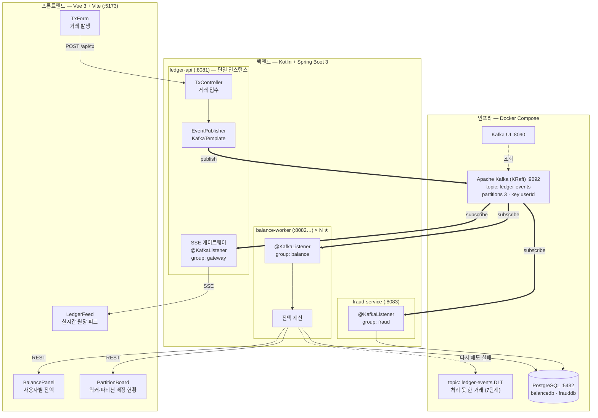
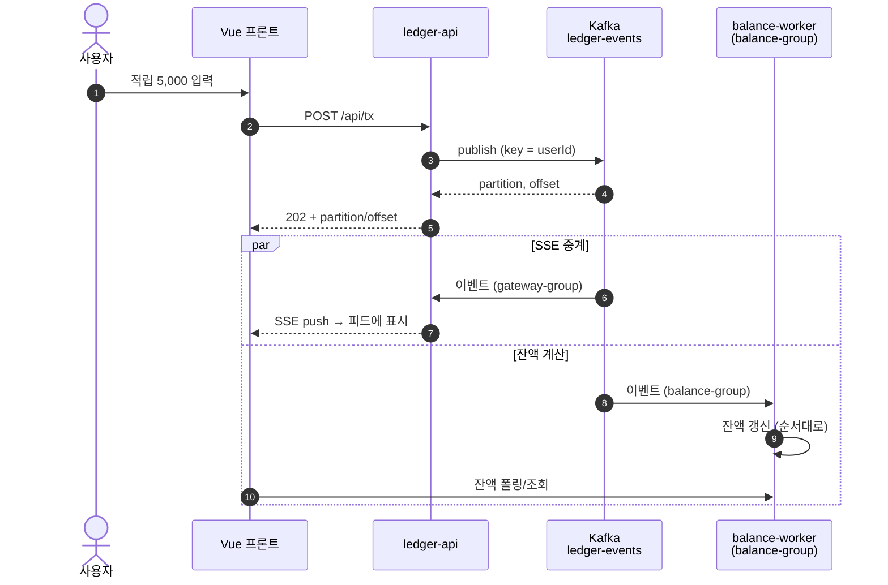
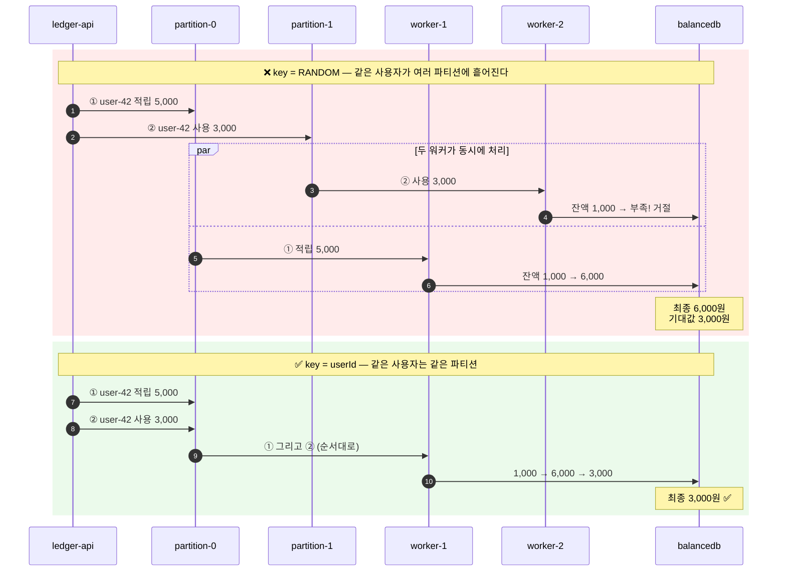
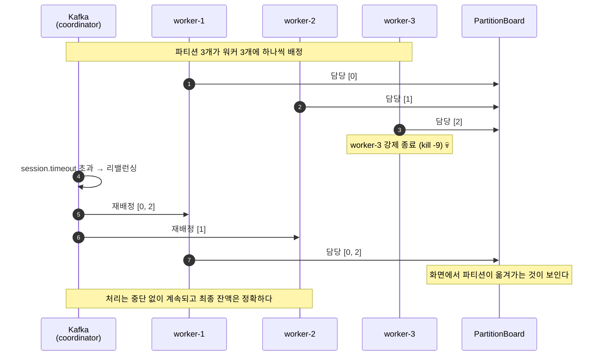
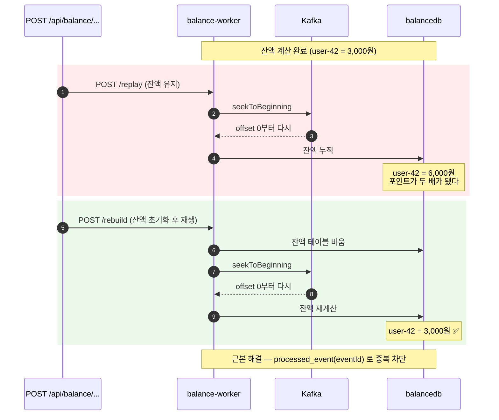
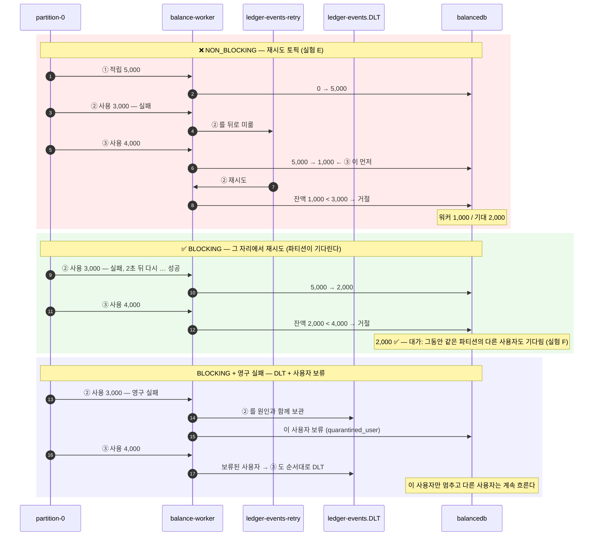
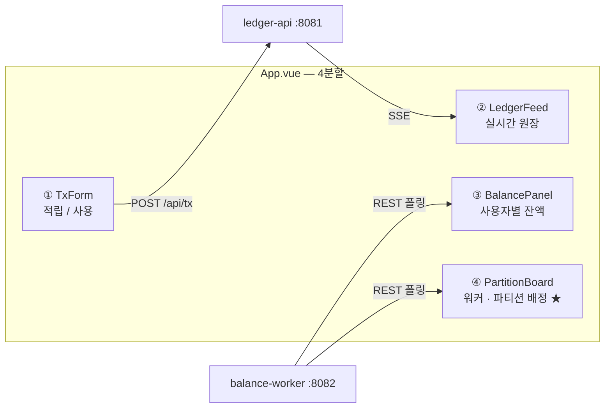
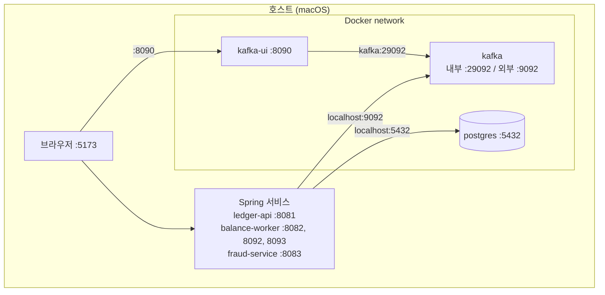

# 02. 설계서

[← README](../../README.md) · [문서 목록](../README.md)

> **이 문서 한눈에**
> - 서비스 3개와 Kafka · PostgreSQL 이 어떻게 연결되는지 **그림으로**
> - 거래 한 건이 화면에 반영되기까지, 그리고 실험 A·B·C·E 에서 무슨 일이 일어나는지 **순서도로**
> - 토픽 · 이벤트 형식 · API · DB 테이블 · 포트 명세


## 1. 전체 아키텍처



### 계층별 역할

| 계층 | 구성 | 역할 |
|---|---|---|
| **프론트엔드** | Vue 3 + Pinia | 거래 발생, 원장 흐름과 **파티션 배정의 시각화** |
| **백엔드** | Kotlin + Spring Boot 3 × 3개 서비스 | Producer 1 + Consumer 2 (+ SSE 게이트웨이) |
| **인프라** | Kafka(KRaft) + Kafka UI + PostgreSQL | 원장 로그 + 파생 상태 저장소 + 관찰 도구 |

### 핵심 설계 포인트

**세 개의 컨슈머 그룹이 같은 토픽을 각자의 offset으로 읽는다.**

| 컨슈머 그룹 | 소속 | 인스턴스 | `auto-offset-reset` | 역할 |
|---|---|---|---|---|
| `gateway-group` | ledger-api | **1개** | `latest` | 전체 파티션 구독 → SSE 중계 |
| `balance-group` | balance-worker | **N개 ★** | `earliest` | 잔액 계산. 순서·병렬·리밸런싱을 실험하는 곳 |
| `fraud-group` | fraud-service | 1개 | `earliest` | 나중에 합류. 과거 전체 재생 |

> **왜 SSE 게이트웨이를 `ledger-api`에 두는가**
>
> `balance-worker`는 여러 인스턴스로 늘어나므로 SSE를 붙이면 브라우저가 그중 하나에만 연결되어
> **일부 이벤트만 보이는 문제**가 생긴다. 단일 인스턴스인 `ledger-api`가 전체 파티션을 구독해 중계하면 이 문제가 없다.
>
> 이것은 우회가 아니라 실무 패턴이다 — **작업 분배(컨슈머 그룹)와 브로드캐스트(SSE)는 다른 레이어**이므로 분리한다.

---

## 2. 서비스별 책임

### ledger-api (:8081) — Producer + SSE 게이트웨이

- `POST /api/tx` — 거래 요청을 받아 `ledger-events`에 발행. **키는 `userId`**
- **DB를 갖지 않는다.** Kafka가 원장의 원본(source of truth)이다
- 별도 컨슈머 그룹(`gateway-group`)으로 전체 파티션을 구독해 SSE로 중계
- **학습용 스위치**: `app.partition-key-mode` = `USER_ID`(정상) \| `RANDOM`(실험 A용)

> 요청을 DB에 저장하지 않는 것이 의도적이다.
> "**로그가 원본이고 나머지는 파생 상태**"라는 구조를 흐리지 않기 위함이다.

### balance-worker (:8082…) ★ — 잔액 계산

**이 프로젝트의 중심 서비스.**

- `ledger-events`를 `balance-group`으로 구독해 잔액을 계산하고 `balancedb`에 저장
- **인스턴스를 여러 개 띄운다.** 파티션이 나뉘어 배정된다
- 파티션을 (재)배정받을 때마다 `worker_assignment` 테이블에 기록 → 프론트가 시각화
- 잔액 조회 / 파티션 배정 조회 REST API 제공 (어느 인스턴스에 물어도 같은 DB를 보므로 동일)
- 5단계에서 **명시적 재생 API**를 갖는다
- 7단계에서 **실패 처리**를 갖는다 — `APP_ERROR_MODE`(`DEFAULT` · `NON_BLOCKING` · `BLOCKING`)로 방식을 바꿔 비교한다.
  `BLOCKING` 은 그 자리에서 다시 시도하고, 다시 해도 안 되는 거래는 `ledger-events.DLT` 로 빼며 **그 사용자를 보류**한다.
  깨진 메시지는 `ErrorHandlingDeserializer` 로 워커를 멈추지 않고 DLT 로 뺀다 ([KS-35](../issues/KS-35-failure-handling.md))

`POINT_SPENT` 처리 시 잔액이 부족하면 **거절**하고 그 사실을 기록한다.
→ 순서가 뒤바뀌면 이 판정이 달라지므로 **잔액이 틀어진다.** 실험 A의 원리.

### fraud-service (:8083) — 나중에 합류하는 소비자

- 6단계에서 **처음** 기동한다. `fraud-group` + `earliest` → 과거 전체를 읽는다
- 사용자별 거래 패턴을 계산해 이상거래를 표시 (단순 규칙: 짧은 시간 내 대량 사용 등)
- **잔액 워커에 아무 영향을 주지 않는다** — 컨슈머 그룹이 다르기 때문

---

## 3. 주요 흐름

### 3-1. 평상시 — 거래 발생부터 화면 반영까지



**핵심**: 컨슈머 그룹마다 같은 메시지를 **각각** 받는다 (지금은 둘, 6단계에서 `fraud-group` 이 합류하면 셋). 큐였다면 하나만 받는다.

### 3-2. ★ 순서가 깨지면 잔액이 틀린다 *(실험 A, 4단계)*



> **파티션 키가 왜 존재하는지를 틀린 숫자로 배운다.**
> `app.partition-key-mode` 설정 한 줄로 재현한다. 되돌리면 **앞으로 발행되는 거래는** 다시 맞지만, 이미 흩어져 기록된 거래는 그대로 남는다 ([KS-20](../issues/KS-20-order-broken-experiment.md)).

### 3-3. 워커 장애와 리밸런싱 *(실험 B, 4단계)*



> 정상 종료(`Ctrl+C`)면 워커가 떠나면서 스스로 알리므로 **몇 초** 만에 재배정된다. 위 그림의 `session.timeout`(기본 45초)을 기다리는 것은 **강제 종료**일 때다 ([KS-21](../issues/KS-21-rebalance-experiment.md)).

### 3-4. 원장 재구축과 중복 적용 *(실험 C, 5단계)*



> **`processed_event` 테이블은 replay 로 잔액이 두 배가 되는 문제를 겪은 뒤에 만든다** (5단계 안에서 순서: replay → rebuild → 멱등).
> 먼저 겪어야 멱등성이 왜 필요한지 확실히 알게 된다. 멱등 처리는 지금도 기본값이 꺼져 있다 (`APP_IDEMPOTENT`).

### 3-5. 처리에 실패하면 *(실험 E · F, 7단계)*

같은 사용자: ① 5,000 적립 ② 3,000 사용 (**5초 일시 실패**) ③ 4,000 사용. 정답은 잔액 2,000, ③ 거절.



> 재시도 토픽은 일반적으로 권장되는 패턴이지만, **순서가 결과를 바꾸는 일**에서는 잔액을 깨뜨린다.
> 영구 실패를 DLT 로 빼기만 하면 ③ 이 ② 를 건너뛴 채 처리되므로, **그 사용자를 보류**해 뒤 거래도 함께 뺀다. → [KS-35](../issues/KS-35-failure-handling.md)
> Kafka의 기본 전달 보장은 **at-least-once**이며, 정상 운영 중 컨슈머 재시작·리밸런싱에서도 발생할 수 있는 일이다.

---

## 4. 프론트엔드 구조

프론트는 **Kafka의 흐름을 눈으로 보는 창**이다. 화면은 최소로 유지한다.



| 컴포넌트 | 역할 | 학습상 의미 |
|---|---|---|
| `TxForm` | userId·금액·적립/사용 입력. userId 프리셋 버튼 | **같은 userId로 연속 거래**를 빠르게 만드는 도구 |
| `LedgerFeed` | 수신 이벤트 목록 + **partition/offset 뱃지** | 같은 userId가 같은 파티션에 들어가는지 눈으로 확인 |
| `BalancePanel` | 사용자별 잔액 + **기대값과의 차이**, rebuild · replay 버튼, 실패 처리 모드와 **"보류"** 사용자 | **실험 A · C · E 에서 잔액이 틀어지는 것이 보이는 화면** |
| `PartitionBoard` ★ | 워커별 담당 파티션, 마지막 하트비트 | **리밸런싱이 실시간으로 보이는 화면** |

> `BalancePanel`은 프론트가 이벤트를 직접 합산한 **기대 잔액**을 함께 표시한다.
> 실험 A에서 워커가 계산한 잔액과 기대 잔액이 **어긋나는 것**이 이 프로젝트의 핵심 장면이다.

### 디렉토리 구조

```
frontend/
├── src/
│   ├── App.vue
│   ├── components/
│   │   ├── TxForm.vue
│   │   ├── LedgerFeed.vue
│   │   ├── BalancePanel.vue
│   │   └── PartitionBoard.vue
│   ├── stores/
│   │   ├── ledger.ts        # SSE 수신 이벤트 + 기대 잔액 계산
│   │   └── balance.ts       # 워커가 계산한 실제 잔액
│   ├── composables/
│   │   └── useSse.ts
│   └── api/
│       ├── ledger.ts        # ledger-api 호출 (거래 · 연속 거래 · 키 모드)
│       └── types.ts
└── vite.config.ts           # dev 프록시로 CORS 회피
```

### SSE 연결 관리

- `onMounted` 연결, `onUnmounted` 해제 — **해제를 빠뜨리면 연결이 누적된다**
- `EventSource`는 끊기면 자동 재연결하지만 **재연결 중 놓친 이벤트는 복구되지 않는다**

> Kafka의 offset은 **컨슈머 서비스가** 어디까지 읽었는지를 기억할 뿐, 브라우저가 어디까지 받았는지는 모른다.
> 서버-브라우저 구간(SSE)과 서버-서버 구간(Kafka)은 다른 레이어다.

### CORS

Vite dev 서버 프록시로 처리한다. 백엔드에 CORS 설정을 흩뿌리지 않는다.

| 프론트 경로 | 프록시 대상 |
|---|---|
| `/api/tx`, `/api/stream` | `localhost:8081` |
| `/api/balance`, `/api/workers` | `localhost:8082` |
| `/api/fraud` | `localhost:8083` |

---

## 5. 인프라 구성



**Postgres는 0단계가 아니라 1단계에서 추가한다.** 컨테이너를 한꺼번에 늘리면 "Kafka가 안 뜬 건지 DB가 안 뜬 건지" 디버깅 표면이 넓어진다.

**Spring 서비스는 컨테이너에 넣지 않는다.** 4단계에서 워커를 껐다 켜는 실험이 반복되는데, 매번 이미지를 빌드하면 학습 리듬이 끊긴다.

### 리스너 분리 — 가장 자주 막히는 지점

브로커는 클라이언트에게 "이 주소로 오라"고 **광고(advertise)** 한다. 잘못되면 **연결은 되는 것 같다가 produce/consume에서 실패**한다.

| 리스너 | 주소 | 사용 주체 |
|---|---|---|
| `INTERNAL` | `kafka:29092` | 같은 네트워크의 컨테이너 (kafka-ui) |
| `EXTERNAL` | `localhost:9092` | 호스트의 Spring 앱, CLI |
| `CONTROLLER` | `kafka:9093` | KRaft 컨트롤러 |

컨테이너 안에서 `localhost`는 **컨테이너 자신**이므로 kafka-ui가 `localhost:9092`로 붙으면 실패한다.
반대로 호스트는 `kafka`라는 호스트명을 모른다. **그래서 분리해야 한다.**

### 볼륨 — 가장 중요한 인프라 조건

Kafka 로그와 Postgres 데이터 모두 named volume에 둔다.

**`docker compose down` 후에도 토픽과 메시지가 유지되어야 한다.**
이것이 깨지면 5단계(재구축)와 6단계(나중에 합류)가 성립하지 않는다.

전체 초기화는 `docker compose down -v`.

### 워커 여러 개 띄우기 (4단계)

**먼저 한 번 빌드한다.** 빌드 없이 여러 개를 동시에 띄우면 Gradle 들이 같은 빌드 폴더를 동시에 컴파일하다 충돌한다([KS-30](../issues/KS-30-readme-build-first.md)).

```bash
./gradlew build
SERVER_PORT=8082 ./gradlew :balance-worker:bootRun
SERVER_PORT=8092 ./gradlew :balance-worker:bootRun
SERVER_PORT=8093 ./gradlew :balance-worker:bootRun
```

같은 `balance-group`이므로 파티션 3개가 나눠 배정된다.

---

## 6. 토픽 설계

### `ledger-events`

| 항목 | 값 | 근거 |
|---|---|---|
| 파티션 수 | 3 | 워커 인스턴스 수와 맞춰 배정·리밸런싱을 관찰 |
| **파티션 키** | **`userId`** | **같은 사용자의 거래 순서 보장. 이 프로젝트의 핵심** |
| 복제 계수 | 1 | 로컬 단일 브로커 (운영이라면 3) |
| retention | 기본 7일 | 학습 중 재생이 가능해야 하므로 충분 |
| 값 형식 | JSON | 기초 단계. Avro/Schema Registry는 범위 밖 |

### 파티션 키가 이 프로젝트의 핵심인 이유

Kafka는 **파티션 내부에서만** 순서를 보장한다. 토픽 전체 순서는 보장하지 않는다.

`userId`를 키로 쓰면 같은 사용자의 거래가 항상 같은 파티션에 들어가고, **한 파티션은 한 워커만 처리**하므로 순서가 지켜진다.

> **"같은 사용자는 순서대로, 다른 사용자는 병렬로"** 라는 요구사항이
> 파티션 키 하나로 정확히 표현된다. 이것이 Kafka 설계의 핵심 아이디어다.

키를 `RANDOM`으로 바꾸면 이 보장이 즉시 무너지고 잔액이 틀어진다 (실험 A).

### 추가 토픽 (7단계, [KS-35](../issues/KS-35-failure-handling.md))

| 토픽 | 만드는 곳 | 용도 |
|---|---|---|
| `ledger-events.DLT` | 워커 기동 시 `NewTopic` 빈 (파티션 3) | `BLOCKING` 모드 — 처리하지 못한 거래 · 깨진 메시지 보관. **원래 파티션 번호 그대로** 보낸다 |
| `ledger-events-retry` · `ledger-events-dlt` | `NON_BLOCKING` 모드일 때 Spring 이 자동 생성 | 재시도 토픽 비교 실험용 |

> **retry topic은 기본으로 쓰지 않는다.** 순서가 깨지기 때문이다 (실험 E — KS-35 에서 확인).
> 실패 처리 모드는 `APP_ERROR_MODE` = `DEFAULT` | `NON_BLOCKING` | `BLOCKING` 으로 바꿔 비교한다.

---

## 7. 이벤트 스키마

`ledger-events`에 두 종류가 흐른다. `eventType`으로 구분하고, **키는 둘 다 `userId`** 다.

### PointEarnedEvent

```json
{
  "eventId": "9f1c2e7a-4b8d-4d5e-9a1f-2c3b4d5e6f70",
  "eventType": "POINT_EARNED",
  "occurredAt": "2026-09-05T14:32:10.123Z",
  "userId": "user-42",
  "amount": 5000,
  "reason": "주문 적립"
}
```

### PointSpentEvent

```json
{
  "eventId": "b3d7f1a2-9c4e-4a6b-8d2f-1e5c7a9b3d40",
  "eventType": "POINT_SPENT",
  "occurredAt": "2026-09-05T14:35:02.000Z",
  "userId": "user-42",
  "amount": 3000,
  "reason": "상품 구매"
}
```

### 필드

| 필드 | 타입 | 설명 |
|---|---|---|
| `eventId` | UUID | **멱등 처리의 기준 키** |
| `eventType` | String | `POINT_EARNED` \| `POINT_SPENT` |
| `occurredAt` | ISO-8601 | 발생 시각 |
| `userId` | String | **파티션 키** |
| `amount` | Long | 금액 (항상 양수. 부호는 `eventType`이 결정) |
| `reason` | String | 표시용 |

### 왜 이벤트에 "잔액"을 담지 않는가

이벤트는 **일어난 사실**만 담는다. 잔액은 이벤트를 순서대로 적용한 **결과**다.

발행 시점에 잔액을 계산해 담으면, 그 순간 발행자가 순서를 알아야 하므로 **병렬 처리가 불가능**해진다.
"로그가 원본이고 상태는 파생"이라는 구조를 지키는 것이 이 설계의 전제다.

---

## 8. API 명세

### ledger-api (:8081)

#### `POST /api/tx` — 거래 발생

```json
{ "userId": "user-42", "type": "EARN", "amount": 5000, "reason": "주문 적립" }
```

응답 `202 Accepted`:
```json
{ "eventId": "9f1c...", "partition": 1, "offset": 137, "keyMode": "USER_ID" }
```

> `partition`/`offset`/`keyMode`는 학습 목적이다. "내 거래가 어느 파티션에 들어갔는지"를 화면에서 바로 본다.
> `KafkaTemplate.send()`는 비동기이므로 이 값을 담으려면 결과를 기다려야 한다 — **응답 지연이 생긴다는 점은 인지한다.**

#### `POST /api/tx/burst` — 연속 거래 생성 (학습용)

```json
{ "users": 5, "txPerUser": 20 }
```

같은 사용자에게 **적립·사용을 빠르게 연속 발생**시킨다.
실험 A에서 순서 문제가 드러나려면 **한 사용자의 거래가 촘촘히 이어져야** 하므로 필요하다.

#### `POST /api/config/partition-key-mode` — 학습용 스위치 ★

```json
{ "mode": "RANDOM" }
```

`USER_ID`(정상) ↔ `RANDOM`(실험 A). **실험 A의 조작 장치.**

#### `GET /api/stream` — 실시간 원장 피드 (SSE)

```
event: ledger
data: { "eventId": "...", "eventType": "POINT_EARNED", "userId": "user-42",
        "amount": 5000, "partition": 1, "offset": 137 }
```

---

### balance-worker (:8082 …)

#### `GET /api/balance` — 사용자별 잔액

```json
{
  "balances": [
    { "userId": "user-42", "balance": 3000, "appliedEvents": 12, "rejectedEvents": 1,
      "updatedAt": "2026-10-20T15:02:11Z" }
  ],
  "totalApplied": 12,
  "totalRejected": 1,
  "idempotent": false,
  "processedEvents": 0,
  "errorMode": "BLOCKING",
  "quarantinedUsers": [
    { "userId": "user-6", "reason": "PermanentFailureException: 영구 실패 표시가 있는 거래 ..." }
  ]
}
```

| 필드 | 단계 | 의미 |
|---|---|---|
| `idempotent` · `processedEvents` | 5단계 | 멱등 처리가 켜져 있는지, `processed_event` 에 기록된 건수 |
| `errorMode` | 7단계 | 실패 처리 모드 (`DEFAULT` · `NON_BLOCKING` · `BLOCKING`) — 화면 ③ 위쪽에 표시 |
| `quarantinedUsers` | 7단계 | 거래가 DLT 로 빠져 처리를 **보류**한 사용자 — 화면에 "보류"로 표시 |

#### `GET /api/workers` — 워커·파티션 배정 현황 ★

```json
{
  "workers": [
    { "workerId": "w-8082", "partitions": [0, 2], "generation": 3,
      "secondsSinceHeartbeat": 1, "alive": true,  "stopped": false },
    { "workerId": "w-8092", "partitions": [],     "generation": 2,
      "secondsSinceHeartbeat": 9, "alive": false, "stopped": true },
    { "workerId": "w-8093", "partitions": [1],    "generation": 1,
      "secondsSinceHeartbeat": 47, "alive": false, "stopped": false }
  ],
  "aliveCount": 1,
  "assignedPartitions": [0, 2]
}
```

| 상태 | 판정 | 화면 표시 |
|---|---|---|
| 하트비트 8초 이내, 종료 기록 없음 | `alive` | 담당 파티션 표시 (없으면 "놀고 있음") |
| 정상 종료하며 스스로 기록 | `stopped` | **"정상 종료"** |
| 하트비트가 8초 넘게 끊김 (`kill -9`) | 둘 다 아님 | **"죽음 (N초)"** |

**`PartitionBoard` 화면의 데이터원.** 리밸런싱이 여기서 눈에 보인다.

#### `POST /api/balance/rebuild` — 전체 재구축 *(5단계)*

잔액 테이블을 **비우고** offset을 처음으로 되감아 전체를 다시 읽는다.
실무의 "집계 로직 변경 후 전체 재구축"에 해당한다.

> ⚠️ **요청을 받은 워커가 맡은 파티션만** 되감는다. 그런데 잔액은 **전부** 비운다.
> 워커가 여러 개일 때 부르면 다른 워커 몫의 잔액이 비워진 채 다시 채워지지 않는다. **워커 1개로 실행한다.**

> 7단계부터는 **보류(`quarantined_user`)도 함께 비운다.** 처음부터 다시 읽으면 실패할 거래는 다시 실패해 다시 보류된다.
> `NON_BLOCKING` 모드에서는 rebuild · replay 모두 **409** 로 거절한다 — 재시도 토픽을 읽는 컨슈머도 같은 리스너를 써서 되감기 콜백이 섞이기 때문이다.

#### `POST /api/balance/replay` — 재생 *(5단계 실험용)*

잔액 테이블을 **비우지 않고** offset만 되감는다.
→ 같은 거래가 두 번 적용되어 **포인트가 두 배가 된다.**

> **왜 CLI `--reset-offsets`가 아니라 API인가**
>
> `kafka-consumer-groups --reset-offsets`는 **활성 컨슈머가 있으면 거부된다.**
> 워커를 내려야 하는데, 그러면 재생 시작 시점에 워커가 방금 뜬 상태라 화면에서 "잔액이 두 배로 뛰는 순간"을 볼 수 없다.
> CLI 방식은 5단계에서 **그 제약 자체를 확인하는 용도**로 별도로 다룬다.

**구현 노트**: `ConsumerSeekAware.registerSeekCallback`에서 받은 콜백을 보관해두고 REST 요청 시 호출한다.
실제 seek은 **다음 poll 직전에 컨슈머 스레드에서** 적용된다. `KafkaConsumer`는 thread-safe하지 않으므로 REST 스레드에서 직접 건드리지 않는다.

#### 재생 속도 조절

`app.replay.delay-ms` (기본 `0`). 데모 시 `50` 정도를 주면 잔액이 변해가는 과정이 눈에 보인다.

---

### fraud-service (:8083) *(6단계)*

#### `GET /api/fraud/alerts` — 이상거래 목록
#### `GET /api/fraud/stream` — 실시간 알림 (SSE)

---

## 9. 데이터 모델

### balance-worker — `balancedb.user_balance`

| 컬럼 | 타입 | 비고 |
|---|---|---|
| `user_id` | VARCHAR | PK |
| `balance` | BIGINT | 현재 잔액 |
| `applied_events` | INT | 적용된 이벤트 수 |
| `rejected_events` | INT | 잔액 부족으로 거절된 수 |
| `updated_at` | TIMESTAMPTZ | |

upsert (PostgreSQL):

```sql
INSERT INTO user_balance (user_id, balance, applied_events)
VALUES (:userId, :delta, 1)
ON CONFLICT (user_id)
DO UPDATE SET balance        = user_balance.balance + :delta,
              applied_events = user_balance.applied_events + 1,
              updated_at     = now();
```

### balance-worker — `balancedb.worker_assignment` ★

| 컬럼 | 타입 | 비고 |
|---|---|---|
| `worker_id` | VARCHAR | PK (예: `w-8082`) |
| `partitions` | VARCHAR | 담당 파티션 (예: `0,2`) |
| `generation` | INT | 리밸런싱 세대 |
| `last_heartbeat` | TIMESTAMPTZ | 2초마다 갱신. 8초 넘게 끊기면 죽은 것으로 본다 |
| `stopped` | BOOLEAN | 정상 종료 시 스스로 기록 ([KS-31](../issues/KS-31-worker-status-and-pins.md)) |

`ConsumerRebalanceListener.onPartitionsAssigned`에서 갱신한다.
**리밸런싱을 화면에 보여주기 위한 테이블이다.**

### balance-worker — `balancedb.quarantined_user` *(7단계에서 추가)*

| 컬럼 | 타입 | 비고 |
|---|---|---|
| `user_id` | VARCHAR | PK |
| `reason` | VARCHAR | 처음 DLT 로 빠진 이유 |
| `quarantined_at` | TIMESTAMPTZ | |

`BLOCKING` 모드에서 거래가 DLT 로 빠지면 그 사용자를 기록한다. 이후 그 사용자의 거래는 처리하지 않고 DLT 로 보낸다
— 앞 거래를 건너뛰고 계산하면 잔액이 틀어지기 때문이다. `rebuild` 때 함께 비운다.

### balance-worker — `balancedb.processed_event` *(5단계에서 추가)*

| 컬럼 | 타입 | 비고 |
|---|---|---|
| `event_id` | UUID | **PK — 멱등성의 핵심** |
| `user_id` | VARCHAR | 조회용 |
| `processed_at` | TIMESTAMPTZ | |

> **PK가 `eventId`다.** 사용자별로 여러 이벤트가 발생하므로 `userId`로는 안 되고,
> 같은 사용자가 같은 금액을 두 번 적립할 수도 있으므로 내용 기반 키도 안전하지 않다.

> **4단계까지는 이 테이블을 만들지 않는다.** 5단계에서 포인트가 두 배가 되는 문제를 먼저 겪어야 한다.

---

## 10. 저장소 정책

| 대상 | 보존 | 이유 |
|---|---|---|
| **Kafka 로그** | `down` 후에도 유지 | **원장의 원본.** 5·6단계가 성립하려면 필수 |
| **Postgres** | 유지 | 파생 상태. 실무와 동일하게 커밋된 offset에서 이어 읽는다 |

### 상태 재구축은 자동이 아니라 명시적이다

실무 컨슈머는 기동할 때마다 처음부터 읽지 않는다. 커밋된 offset부터 **이어서** 읽는다.
데이터가 수백만 건이면 매 기동마다 전체 재생은 애초에 불가능하다.

| 상황 | 읽기 시작점 | 잔액 테이블 |
|---|---|---|
| 최초 기동 | offset 0 (`auto-offset-reset: earliest`) | 비어 있음 |
| 재기동 (평상시) | 커밋된 offset에서 이어서 | 유지 |
| `POST /rebuild` | offset 0 (명시적 seek) | **비움** |
| `POST /replay` | offset 0 (명시적 seek) | **유지** → 두 배 |

"상태는 로그로부터 재구축된다"는 발상은 `rebuild`를 누를 때마다 체험한다.
**자동이 아니라 명시적이므로 정상 동작에 대한 감각을 왜곡하지 않는다.**

---

## 11. 포트 정리

| 대상 | 포트 |
|---|---|
| Kafka (브로커) | 9092 |
| Kafka UI | **8090** (컨테이너 내부는 8080) |
| PostgreSQL | 5432 |
| ledger-api | 8081 |
| balance-worker | 8082 (추가 인스턴스 8092, 8093) |
| fraud-service | 8083 |
| 프론트엔드 (Vite dev) | 5173 |

---

## 12. 모듈 구조

```
kafka_study/
├── docs/
├── docker/
│   ├── docker-compose.yml          # Kafka(KRaft) + Kafka UI + PostgreSQL
│   └── init/
│       └── 01-create-databases.sql # balancedb / frauddb
├── backend/                        # Gradle 멀티모듈 (Kotlin DSL)
│   ├── settings.gradle.kts
│   ├── build.gradle.kts
│   ├── common/                     # 이벤트 DTO
│   ├── ledger-api/
│   ├── balance-worker/
│   └── fraud-service/
└── frontend/                       # Vue 3 + Vite
```

`common` 모듈에 `PointEarnedEvent` / `PointSpentEvent`를 두어 세 서비스가 같은 스키마를 공유한다.

> 실무에서는 서비스별로 스키마를 복제하거나 Schema Registry로 관리하는 것이 일반적이다.
> 공유 모듈은 **스키마 진화 학습이 구조적으로 불가능**하다는 한계가 있으나, 이 프로젝트 범위 밖이므로 감수한다.
