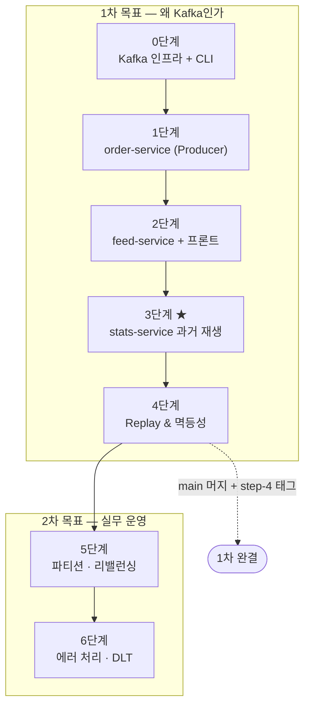

# 04. 작업 로드맵

[01. 기획서](01-planning.md)의 학습 단계를 **실제 작업 단위로 분해**한 문서.
티켓은 이 로드맵을 따라 발급한다.

## 원칙

- **한 티켓 = 한 번에 눈으로 확인 가능한 것.** 확인할 수 없으면 더 쪼갠다
- **인프라 → 데이터 생성 → 관찰 수단 → 실험** 순서. 실험은 관찰 수단이 있어야 의미가 있다
- 티켓 번호는 **착수 시점에 발급**한다 (미리 예약하지 않는다)

## 전체 그림

**3단계가 이 프로젝트의 목적지다.** 0~2단계는 3단계를 성립시키기 위한 준비다.

---

## 0단계 — Kafka 인프라

Postgres는 아직 띄우지 않는다. Kafka만으로 개념을 먼저 잡는다.

| # | 작업 | 확인 방법 |
|---|---|---|
| 0-1 | `docker/docker-compose.yml` — Kafka(KRaft) + Kafka UI | `docker compose up -d` 후 `localhost:8080` 접속 |
| 0-2 | 리스너 분리 검증 (`INTERNAL` / `EXTERNAL`) | 호스트 CLI와 kafka-ui **양쪽 다** 접속됨 |
| 0-3 | `order-events` 토픽 생성 (파티션 3) | Kafka UI에서 파티션 3개 확인 |
| 0-4 | CLI 실습 — 키별 파티션 배치 | 같은 키 메시지가 **항상 같은 파티션** |
| 0-5 | CLI 실습 — 컨슈머 그룹 2개 | 같은 메시지를 **양쪽 다** 수신 |
| 0-6 | CLI 실습 — `--from-beginning` | 이미 소비한 메시지를 **다시** 읽음 |
| 0-7 | 볼륨 검증 | `docker compose down` 후 재기동해도 **메시지 유지** |

> 0-4 ~ 0-6이 이 단계의 핵심이다. **Spring이 감춰주기 전에 Kafka가 큐와 다르다는 것을 CLI 수준에서 먼저 확인한다.**
> 0-7이 깨지면 3단계가 성립하지 않으므로 반드시 확인한다.

**예상 난관**: `advertised.listeners`. 연결은 되는 것 같다가 produce/consume에서 실패하면 이 문제다. → `docs/troubleshooting/`에 기록.

---

## 1단계 — order-service (Producer)

| # | 작업 | 확인 방법 |
|---|---|---|
| 1-1 | Gradle 멀티모듈 뼈대 (`backend/`, Kotlin DSL, JDK 17 toolchain) | `./gradlew build` 성공 |
| 1-2 | `common` 모듈 — `OrderCreatedEvent` / `OrderCanceledEvent` 정의 | 컴파일 |
| 1-3 | Kotlin + JPA 플러그인 설정 (`kotlin-spring`, `kotlin-jpa`) | 엔티티 클래스가 `open`으로 컴파일됨 |
| 1-4 | 컴포즈에 Postgres 추가 + `orderdb`/`statsdb` 생성 스크립트 | `psql`로 두 DB 접속 |
| 1-5 | `Order` 엔티티 + Repository (`orderdb`) | 저장/조회 테스트 |
| 1-6 | `POST /api/orders` — 저장 후 Kafka 발행 (키 = `userId`) | 201 응답 + Kafka UI에 메시지 |
| 1-7 | 응답에 `partition` / `offset` 포함 | 응답 JSON 확인 |
| 1-8 | 같은 `userId`로 반복 주문 | Kafka UI에서 **파티션 고정** 확인 |
| 1-9 | `POST /api/orders/{id}/cancel` — `ORDER_CANCELED` 발행 | 200 응답 + Kafka UI에 이벤트 |
| 1-10 | 생성·취소가 **같은 파티션**에 들어가는지 확인 | Kafka UI에서 파티션 번호 일치 |
| 1-11 | `POST /api/orders/seed` — 여러 날짜에 걸친 시드 생성 | 40건 생성, 일부 취소 |

> 1-3은 Kotlin+JPA의 알려진 마찰 지점이다. 엔티티를 `data class`로 만들지 않는다 —
> `equals`/`hashCode`가 lazy 프록시와 충돌한다. `data class`는 이벤트 DTO에만 쓴다.

> **1-10이 파티션 키 설계의 진짜 이유다.** 같은 주문의 생성·취소가 다른 파티션에 흩어지면
> 컨슈머가 **취소를 생성보다 먼저 볼 수 있고**, 그러면 집계가 깨진다.
> 두 이벤트 모두 키를 `userId`로 두어 같은 파티션에 순서대로 넣는다.

> **1-11은 3단계의 재료를 만드는 장치다.** 일자별 매출 차트를 보려면 여러 날짜의 데이터가 필요한데,
> 하루에 손으로 만들면 전부 오늘 날짜라 막대 하나로 끝난다.

---

## 2단계 — feed-service + 프론트

| # | 작업 | 확인 방법 |
|---|---|---|
| 2-1 | `feed-service` — `@KafkaListener` (`feed-group`, `latest`) | 로그에 이벤트 출력 |
| 2-2 | SSE 엔드포인트 `GET /api/feed/stream` | `curl -N`로 스트림 수신 |
| 2-3 | Vue 프로젝트 뼈대 + Vite 프록시 (3개 백엔드) | `npm run dev` 기동 |
| 2-4 | `OrderForm` — 주문 생성 폼 | 폼 제출 → 201 |
| 2-5 | `useSse` 컴포저블 (연결/해제) | 언마운트 시 연결 해제 확인 |
| 2-6 | `OrderFeed` — 실시간 목록 + **partition/offset 뱃지** + 생성/취소 구분 | 주문 넣으면 즉시 표시 |
| 2-7 | 피드 행에서 취소 버튼 → 취소 이벤트가 피드에 추가로 나타남 | 같은 주문의 두 이벤트가 보임 |
| 2-8 | 같은 `userId`로 반복 주문 | 뱃지의 **partition 번호 고정**이 화면에서 보임 |

> 2-8이 2단계의 학습 지점이다. 파티션 개념을 **화면에서 직접** 체감한다.
> 2-7에서 생성·취소가 **같은 파티션 번호**로 나란히 쌓이는 것도 함께 확인한다.

**여기까지 끝나면 시드로 최근 7일에 걸쳐 40건 정도를 만들고 일부를 취소해둔다.** 3단계의 재료다.

---

## 3단계 ★ — stats-service 과거 재생

> **⚠️ 이 단계는 순서가 중요하다.** stats-service를 **실수로 먼저 켜면** 최초 합류 순간이 사라진다.
> 코드를 다 작성한 뒤, 주문이 충분히 쌓인 것을 확인하고 **그때 처음 기동**한다.

| # | 작업 | 확인 방법 |
|---|---|---|
| 3-1 | `stats-service` 뼈대 + `statsdb` 연결 | 기동 성공 (아직 리스너 없음) |
| 3-2 | `DailyRevenue` / `ProductStats` 엔티티 + upsert (`ON CONFLICT`) | 단위 테스트 |
| 3-3 | 두 이벤트 타입 분기 처리 (생성 `+`, 취소 `−`) | 단위 테스트 |
| 3-4 | `@KafkaListener` (`stats-group`, `earliest`) — **아직 기동하지 않는다** | 컴파일만 |
| 3-5 | `GET /api/stats` + SSE `GET /api/stats/stream` | - |
| 3-6 | `StatsPanel` — **일자별 매출 막대 차트** (Chart.js) | - |
| 3-7 | `app.replay.delay-ms` 설정 (기본 0, 데모 시 50) | - |
| 3-8 | **최초 기동** — 이벤트가 쌓인 상태에서 처음 켠다 | **차트가 0에서 시작해 과거 데이터로 채워짐** |
| 3-9 | ★ **취소된 주문이 생성일 매출에 남아 있는지** 확인 | 취소일에만 차감됨 |
| 3-10 | `GET /api/orders`(DB 현재 상태)와 비교 | DB로는 재현 불가함을 확인 |
| 3-11 | Kafka UI에서 `stats-group` offset 확인 | `feed-group`과 **offset이 다름** |
| 3-12 | `POST /api/stats/rebuild` — 데모 반복용 | 몇 번이든 3-8을 재현 |

> **3-9와 3-10이 이 프로젝트 전체의 결론이다.**
> DB의 `orders` 테이블은 취소된 주문을 `status = CANCELED`로만 알고 있어 **언제 취소됐는지 모른다.**
> 이벤트 로그를 재생한 stats는 "3월 생성, 4월 취소"를 정확히 재현한다.
> **"DB는 지금을 알고, 이벤트 로그는 과거를 안다"** 가 두 화면의 숫자 차이로 증명된다.

> 3-11은 개념적 확인이다. 두 컨슈머 그룹이 **같은 토픽을 각자의 위치로** 읽고 있다는 것이 숫자로 보인다.
> 3-12는 보험이자 실무 기능(집계 로직 변경 시 전체 재구축)이다.

---

## 4단계 — Replay & 멱등성

| # | 작업 | 확인 방법 |
|---|---|---|
| 4-1 | `ConsumerSeekAware` — `ConsumerSeekCallback` 보관 | - |
| 4-2 | `POST /api/stats/replay` — 집계 **유지한 채** seek | **매출이 정확히 2배** 😱 |
| 4-3 | 2배가 되는 과정을 화면에서 관찰 | 차트가 실시간으로 두 배로 점프 |
| 4-4 | `processed_event` 테이블 추가 (**`event_id` PK**) | - |
| 4-5 | 멱등 처리 — 이미 처리한 `eventId`는 skip | replay 해도 **매출 불변** |
| 4-6 | `rebuild` vs `replay` 차이 정리 | 문서화 |
| 4-7 | CLI `kafka-consumer-groups --reset-offsets` 시도 | **활성 컨슈머가 있으면 거부**됨을 확인 |

> 4-4를 **3단계에서 미리 만들지 않는다.** 4-2의 😱를 먼저 겪어야 이 테이블의 필요성이 몸에 남는다.

> **PK가 `order_id`가 아니라 `event_id`인 것이 함정이다.** 같은 주문에 `CREATED`와 `CANCELED`
> 두 이벤트가 있으므로, `order_id`를 키로 쓰면 **취소 이벤트가 "이미 처리함"으로 버려진다.**
> 직접 `order_id`로 만들어보고 취소가 반영되지 않는 것을 확인한 뒤 고치면 학습 효과가 크다.
> 4-7은 "왜 API로 만들었는가"의 근거를 직접 확인하는 작업이다.

**여기서 `dev` → `main` 머지 + `step-4` 태그. 1차 완결.**

---

## 5단계 — 파티션 & 리밸런싱 *(2차)*

| # | 작업 | 확인 방법 |
|---|---|---|
| 5-1 | `feed-service` 3개 인스턴스 기동 (포트만 다르게) | Kafka UI에서 파티션 분배 확인 |
| 5-2 | 주문 10건 투입 | **화면에 3건 정도만 보인다** (의도된 결과) |
| 5-3 | 왜 깨지는지 분석 및 문서화 | 컨슈머 그룹 = 분배 / SSE = 인스턴스 로컬 |
| 5-4 | 인스턴스 하나 종료 | 리밸런싱 발생, 파티션 재배정 |
| 5-5 | 해결책 논의 (Redis Pub/Sub 등) — **구현은 하지 않는다** | 문서화 |

> 5-2는 버그가 아니라 이 단계의 목적이다. **"Kafka는 SSE 연결 문제를 해결하는 도구가 아니다"** 가 실물로 확인된다.
> 5-5를 구현까지 하면 프로젝트가 다른 주제로 번진다. 왜 필요한지 이해하는 것까지가 범위다.

---

## 6단계 — 에러 처리 & DLT *(2차)*

대상은 `stats-service`. 집계 로직에서 예외를 던지기가 자연스럽다.

| # | 작업 | 확인 방법 |
|---|---|---|
| 6-1 | 특정 조건에서 예외를 던지는 코드 삽입 | 컨슈머가 무한 재시도로 멈추는 것 확인 |
| 6-2 | `DefaultErrorHandler` + 백오프 설정 | 재시도 횟수 제한 |
| 6-3 | retry topic + DLT 구성 | 실패 메시지가 `order-events-dlt`로 이동 |
| 6-4 | Kafka UI에서 DLT 내용 확인 | 실패 메시지와 원인 헤더 |

> 6-1이 먼저다. **DLT 없이 컨슈머 전체가 멈추는 상황을 겪어야** 왜 필요한지 안다.
> 이 프로젝트는 일관되게 "문제를 먼저 겪고 해결한다"는 순서를 따른다.

---

## 범위 밖으로 명확히 둔 것

| 항목 | 이유 |
|---|---|
| Kubernetes | Kafka 학습이 쿠버 학습에 묻힌다 |
| Redis Pub/Sub 구현 (5-5) | 왜 필요한지 이해까지가 범위 |
| Avro / Schema Registry | 별도 심화 주제 |
| Kafka Streams | 진입장벽이 높고 핵심과 별개 |
| 트랜잭셔널 아웃박스 | 중요하지만 로그 재생이라는 핵심과 별개 |
| Exactly-once (트랜잭션) | 4단계 멱등성이 더 실용적 |
