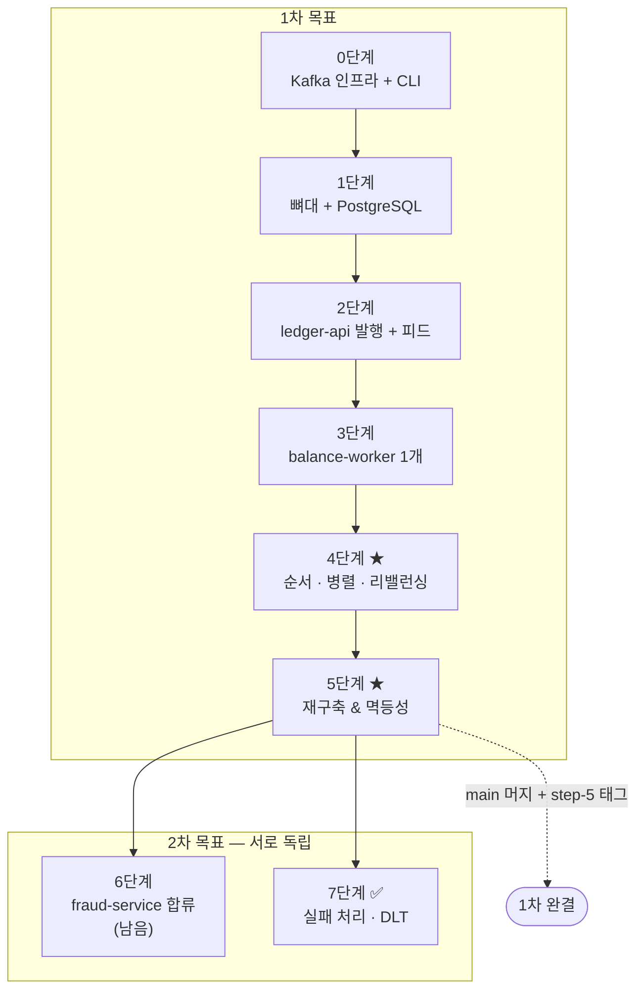

# 04. 작업 로드맵

[← README](../../README.md) · [문서 목록](../README.md)

> **이 문서 한눈에**
> - 0~7단계를 **실제 작업 단위로 쪼갠 계획표**
> - 단계마다 "무엇을 눈으로 확인하면 끝인가"
> - 계획이다. 실제로 어떻게 됐는지는 [06. 진행 기록](06-progress.md)에 있다

[01. 기획서](01-planning.md)의 학습 단계를 **실제 작업 단위로 분해**한 문서.
티켓은 이 로드맵을 따라 발급한다.

## 원칙

- **한 티켓 = 한 번에 눈으로 확인 가능한 것.** 확인할 수 없으면 더 쪼갠다
- **인프라 → 발행 → 관찰 수단 → 실험** 순서. 실험은 관찰 수단이 있어야 의미가 있다
- 티켓 번호는 **착수 시점에 발급**한다 (미리 예약하지 않는다)
- 이 프로젝트는 일관되게 **"문제를 먼저 겪고 해결한다"** 는 순서를 따른다

## 전체 그림

**4단계가 목적지다.** 0~3단계는 4단계를 성립시키기 위한 준비다.

---

## 0단계 — Kafka 인프라 ✅

> 완료: [KS-2](../issues/KS-2-infra-docker-compose.md) · [KS-3](../issues/KS-3-kafka-cli-basics.md) — 태그 `step-0`

Postgres는 아직 띄우지 않는다. Kafka만으로 개념을 먼저 잡는다.

| # | 작업 | 확인 방법 |
|---|---|---|
| 0-1 | `docker/docker-compose.yml` — Kafka(KRaft) + Kafka UI | `docker compose up -d` 후 `localhost:8090` |
| 0-2 | 리스너 분리 (`INTERNAL` / `EXTERNAL` / `CONTROLLER`) | 호스트 CLI와 kafka-ui **양쪽 다** 접속 |
| 0-3 | Kafka 로그용 named volume | `down` → `up` 후 토픽 유지 |
| 0-4 | `ledger-events` 토픽 생성 (파티션 3) | Kafka UI에서 파티션 3개 확인 |
| 0-5 | CLI — 키별 파티션 배치 | 같은 키가 **항상 같은 파티션** |
| 0-6 | CLI — 컨슈머 그룹 2개 | 같은 메시지를 **양쪽 다** 수신 |
| 0-7 | CLI — 컨슈머 인스턴스 2개를 **같은 그룹**으로 | 파티션이 **나눠서** 배정됨 |
| 0-8 | CLI — `--from-beginning` | 이미 소비한 메시지를 **다시** 읽음 |

> 0-6과 0-7의 차이가 핵심이다. **다른 그룹이면 둘 다 받고, 같은 그룹이면 나눠 갖는다.**
> 이 프로젝트는 두 가지를 모두 쓴다 (SSE 게이트웨이 vs 잔액 워커).

> 0-3이 깨지면 5·6단계가 성립하지 않으므로 반드시 확인한다.

**예상 난관**: `advertised.listeners`. 연결은 되는 것 같다가 produce/consume에서 실패하면 이 문제다.

---

## 1단계 — 뼈대 + PostgreSQL ✅

> 완료: [KS-4](../issues/KS-4-gradle-multimodule.md) · [KS-5](../issues/KS-5-postgres-setup.md) — 태그 `step-1`

| # | 작업 | 확인 방법 |
|---|---|---|
| 1-1 | Gradle 멀티모듈 (`backend/`, Kotlin DSL, JDK 17 toolchain) | `./gradlew build` |
| 1-2 | `kotlin-spring`(allopen), `kotlin-jpa`(noarg) 플러그인 | 엔티티가 `open` 없이 컴파일 |
| 1-3 | `common` — `PointEarnedEvent` / `PointSpentEvent` | 컴파일 |
| 1-4 | `eventType` 기반 다형 역직렬화 (Jackson `@JsonSubTypes`) | JSON → 올바른 타입 테스트 |
| 1-5 | Jackson `JavaTimeModule` (`Instant`) | 직렬화 테스트 |
| 1-6 | 컴포즈에 Postgres 추가 + `balancedb`/`frauddb` 생성 | `psql`로 두 DB 접속 |
| 1-7 | 세 서비스 빈 모듈 기동 | 각각 포트에서 기동 |

> 1-2는 Kotlin+JPA의 알려진 마찰 지점이다. **엔티티는 `data class`로 만들지 않는다** —
> `equals`/`hashCode`가 lazy 프록시와 충돌한다. `data class`는 이벤트 DTO에만 쓴다.

---

## 2단계 — ledger-api 발행 + 실시간 피드 ✅

> 완료: [KS-14](../issues/KS-14-ledger-api-publish.md) · [KS-15](../issues/KS-15-frontend-ledger-feed.md) — 태그 `step-2`

| # | 작업 | 확인 방법 |
|---|---|---|
| 2-1 | `POST /api/tx` — `ledger-events`에 발행 (키 = `userId`) | 202 + Kafka UI에 메시지 |
| 2-2 | 응답에 `partition` / `offset` 포함 | 응답 JSON |
| 2-3 | SSE 게이트웨이 — `gateway-group`으로 전체 구독 → SSE | `curl -N` |
| 2-4 | `POST /api/tx/burst` — 연속 거래 생성 | 100건 생성 |
| 2-5 | Vue 프로젝트 뼈대 + Vite 프록시 | `npm run dev` |
| 2-6 | `TxForm` — 적립/사용, userId 프리셋 | 폼 제출 → 202 |
| 2-7 | `useSse` 컴포저블 (연결/해제) | 언마운트 시 해제 확인 |
| 2-8 | `LedgerFeed` — 실시간 목록 + **partition/offset 뱃지** | 거래 넣으면 즉시 표시 |
| 2-9 | 같은 `userId`로 반복 거래 | 뱃지의 **partition 번호 고정** |

> **`ledger-api`는 DB를 갖지 않는다.** Kafka가 원장의 원본이다.
> 요청을 DB에 저장하면 "로그가 원본이고 나머지는 파생 상태"라는 구조가 흐려진다.

> 2-3에서 SSE를 `ledger-api`(단일 인스턴스)에 두는 것이 중요하다.
> 워커에 두면 4단계에서 인스턴스가 늘 때 브라우저가 일부 이벤트만 받게 된다.

---

## 3단계 — balance-worker 1개 ✅

> 완료: [KS-16](../issues/KS-16-balance-worker.md) · [KS-17](../issues/KS-17-balance-panel.md) · [KS-18](../issues/KS-18-worker-restart-offset.md) — 태그 `step-3`

아직 인스턴스는 하나다. **여기까지는 순서 문제가 발생하지 않는다.**

| # | 작업 | 확인 방법 |
|---|---|---|
| 3-1 | `@KafkaListener` (`balance-group`, `earliest`) | 로그에 이벤트 |
| 3-2 | `UserBalance` 엔티티 + 갱신 | 단위 테스트 |
| 3-3 | 이벤트 타입 분기 — 적립 `+`, 사용 `−` | 단위 테스트 |
| 3-4 | 잔액 부족 시 **거절** 처리 + 기록 | 잔액보다 큰 사용 → 거절 |
| 3-5 | `GET /api/balance` | 잔액 조회 |
| 3-6 | `BalancePanel` — 사용자별 잔액 표시 | 화면에 반영 |
| 3-7 | **기대 잔액**을 프론트에서 별도 계산해 나란히 표시 ★ | 둘이 일치함 |
| 3-8 | 워커 재기동 → 커밋된 offset에서 이어 읽는지 확인 | 잔액 유지, 중복 없음 |

> **3-7이 4단계의 준비물이다.** 프론트가 SSE로 받은 이벤트를 스스로 합산한 값과,
> 워커가 계산해 DB에 저장한 값을 나란히 보여준다.
> 지금은 둘이 같지만, **4단계에서 어긋나는 순간이 이 프로젝트의 결정적 장면**이다.

> 3-4가 순서 의존성을 만든다. 거절 판정이 그 시점 잔액에 좌우되므로 순서가 바뀌면 결과가 달라진다.

> **📌 실제 구현에서 바뀐 것 — 원자적 upsert 를 쓰지 않았다**
>
> 원래 `INSERT ... ON CONFLICT ... DO UPDATE` 를 쓰려 했으나 **필요가 없었다.**
> 파티션 키가 `userId` 이고 한 파티션은 한 워커만 처리하므로,
> 같은 사용자의 거래는 언제나 한 워커가 순서대로 다룬다 — **경합 자체가 발생하지 않는다.**
> JPA `findById` + `save` 로 충분하다.
>
> **파티션 키가 순서 보장뿐 아니라 동시성 안전도 준다**는 발견이며,
> 4단계에서 키를 흩뜨리면 이 전제가 무너져 lost update 가 생긴다.
> → [KS-16](../issues/KS-16-balance-worker.md)

---

## 4단계 ★ — 순서 · 병렬 · 리밸런싱 ✅

> 완료: [KS-19](../issues/KS-19-worker-scale-out.md) · [KS-20](../issues/KS-20-order-broken-experiment.md) · [KS-21](../issues/KS-21-rebalance-experiment.md) — 태그 `step-4`

**이 프로젝트의 목적지.**

### 4-A. 순서가 깨지는 것을 목격한다 (실험 A)

| # | 작업 | 확인 방법 |
|---|---|---|
| 4-1 | 워커 인스턴스 3개 기동 (포트만 다르게) | Kafka UI에서 파티션 분배 |
| 4-2 | `app.partition-key-mode` 스위치 구현 (`USER_ID` / `RANDOM`) | 설정 반영 |
| 4-3 | `POST /api/config/partition-key-mode` → `RANDOM` | 응답의 `keyMode` 변경 |
| 4-4 | `POST /api/tx/burst`로 연속 거래 투입 | 같은 userId가 여러 파티션에 흩어짐 |
| 4-5 | ★ **화면에서 잔액과 기대 잔액이 어긋나는 것 확인** | **숫자가 다르다** 😱 |
| 4-6 | 키를 `USER_ID`로 되돌리고 `rebuild` | **숫자가 일치한다** ✅ |

> **4-5가 이 프로젝트 전체의 하이라이트다.**
> 파티션 키가 왜 존재하는지를 설명이 아니라 **틀린 숫자로** 배운다.

### 4-B. 리밸런싱을 관찰한다 (실험 B)

| # | 작업 | 확인 방법 |
|---|---|---|
| 4-7 | `ConsumerRebalanceListener` — 배정 파티션을 `worker_assignment`에 기록 | 테이블 확인 |
| 4-8 | `GET /api/workers` | JSON 응답 |
| 4-9 | `PartitionBoard` 화면 — 워커별 담당 파티션 ★ | 3개 워커가 각각 1개씩 |
| 4-10 | 워커 하나 종료 | **화면에서 파티션이 재배정되는 것이 보인다** |
| 4-11 | 재배정 후에도 잔액이 정확한지 확인 | 기대 잔액과 일치 |
| 4-12 | 워커를 다시 띄우기 | 다시 3개로 재배정 |
| 4-13 | 워커 4개 (파티션 3개) | **하나는 놀고 있다** — 파티션 수가 병렬도의 상한 |

> 4-13이 중요한 발견이다. **컨슈머를 늘려도 파티션 수를 넘어서면 소용이 없다.**
> 파티션 수 설계가 왜 중요한지가 여기서 나온다.

---

## 5단계 ★ — 원장 재구축 & 멱등성 ✅

> 완료: [KS-22](../issues/KS-22-replay-api.md) · [KS-23](../issues/KS-23-idempotency-experiment.md) — 태그 `step-5` · **1차 완결**

| # | 작업 | 확인 방법 |
|---|---|---|
| 5-1 | `ConsumerSeekAware` — `ConsumerSeekCallback` 보관 | - |
| 5-2 | `POST /api/balance/replay` — 잔액 **유지한 채** seek | **포인트가 두 배** 😱 |
| 5-3 | 두 배가 되는 과정을 화면에서 관찰 (`app.replay.delay-ms`) | 잔액이 실시간으로 증가 |
| 5-4 | `POST /api/balance/rebuild` — 잔액 **비우고** seek | 정확히 복원 ✅ |
| 5-4b | `clearAll()` 이 **처리 기록도** 비우게 한다 | 안 그러면 rebuild 가 전부 skip |
| 5-5 | 잔액 계산 로직에 버그를 넣었다 고치고 `rebuild` | 원장이 올바르게 재구축 |
| 5-6 | `processed_event` 테이블 추가 (**`event_id` PK**) | - |
| 5-7 | 멱등 처리 — 이미 처리한 `eventId`는 skip | `replay` 해도 **잔액 불변** ✅ |
| 5-8 | CLI `kafka-consumer-groups --reset-offsets` 시도 | **활성 컨슈머가 있으면 거부**됨 확인 |
| 5-9 | `rebuild` vs `replay` vs 멱등 처리의 차이 정리 | 문서화 |

> 5-6을 **4단계에서 미리 만들지 않는다.** 5-2의 😱를 먼저 겪어야 필요성이 몸에 남는다.

> 5-8은 "왜 CLI가 아니라 API로 만들었는가"의 근거를 직접 확인하는 작업이다.

> **📌 실제 진행에서 추가된 제약 — 워커 1개로 실험한다**
>
> `rebuild` 를 호출하면 **그 워커가 담당한 파티션만** 되감긴다.
> 워커가 여러 개면 각자에게 호출해야 한다. 분산 재생 조율은 이 프로젝트 범위 밖이므로,
> 5단계는 **워커 1개**로 진행했다. 재생의 본질(offset seek)을 보는 것이 목적이다.

**여기서 `dev` → `main` 머지 + `step-5` 태그. 1차 완결.**

---

## 6단계 — fraud-service 합류 *(2차)*

> **⚠️ 순서가 중요하다.** 거래가 충분히 쌓인 뒤 **처음** 기동한다. 먼저 켜면 "최초 합류" 순간이 사라진다.

| # | 작업 | 확인 방법 |
|---|---|---|
| 6-1 | `fraud-service` 뼈대 + `frauddb` | 기동 (아직 리스너 없음) |
| 6-2 | 이상 징후 규칙 (짧은 시간 내 대량 사용 등) | 단위 테스트 |
| 6-3 | `@KafkaListener` (`fraud-group`, `earliest`) — **아직 기동하지 않는다** | 컴파일만 |
| 6-4 | `GET /api/fraud/alerts` + SSE | - |
| 6-5 | **최초 기동** — 거래가 쌓인 상태에서 처음 켠다 | 과거 전체를 읽어 알림 생성 |
| 6-6 | 이때 `balance-worker`가 영향받지 않는지 확인 ★ | **잔액 불변, offset 불변** |
| 6-7 | Kafka UI에서 세 그룹의 offset 비교 | 셋이 **서로 다르다** |

> **6-6이 개념적 결론이다.** 새 소비자가 과거 전체를 읽는 동안 기존 소비자는 아무 영향도 받지 않는다.
> 큐였다면 불가능하다 — 메시지를 나눠 갖거나 이미 사라졌기 때문이다.

---

## 7단계 — 실패 처리 & DLT *(2차)* — ✅ 완료 [KS-35](../issues/KS-35-failure-handling.md)

대상은 `balance-worker`. **요구사항 1(순서)과 6(실패 처리)이 충돌하는 지점이다.**

| # | 작업 | 확인 방법 |
|---|---|---|
| 7-1 | 특정 조건에서 예외를 던지는 코드 삽입 | ~~워커가 무한 재시도로 멈춤~~ → 실제로는 **10번 다시 하고 조용히 건너뛴다** (KS-35) |
| 7-2 | ★ **non-blocking retry(retry topic) 구성** | 실패 이벤트가 나중에 처리됨 |
| 7-3 | ★ **잔액이 틀어지는 것 확인** (실험 E) | 순서가 깨져 기대값과 불일치 😱 |
| 7-4 | blocking retry로 전환 (`DefaultErrorHandler` + 백오프) | 잔액 정확 ✅ |
| 7-5 | 한 사용자의 거래가 계속 실패하게 만들기 (실험 F) | **같은 파티션의 다른 사용자도 멈춤** |
| 7-6 | 영구 실패 판별 → DLT로 격리 | 파티션이 다시 흐름 |
| 7-7 | Kafka UI에서 DLT 내용과 원인 헤더 확인 | 실패 메시지 확인 |
| 7-8 | 일시적 실패(재시도) vs 영구 실패(DLT) 기준 정리 | 문서화 |

> **7-3이 이 단계의 핵심이다.** Spring Kafka가 권장하는 표준 패턴(non-blocking retry)이
> **이 도메인에서는 원장을 깨뜨린다.** 블로그 예제를 따라만 해서는 절대 나오지 않는 학습이다.

> 7-1을 먼저 한다. **실패 처리를 정하지 않으면 무슨 일이 생기는지 먼저 겪어야** 왜 필요한지 안다.
> 계획할 때는 "워커가 멈춘다"고 예상했지만, 실제로는 **조용히 건너뛰어 잔액이 틀렸다** — 멈추는 것보다 알아채기 어렵다.

> **📌 실제 진행에서 추가된 것 ([KS-35](../issues/KS-35-failure-handling.md))**
>
> - 세 방식을 코드 브랜치가 아니라 `APP_ERROR_MODE`(`DEFAULT` · `NON_BLOCKING` · `BLOCKING`)로 바꿔 가며 비교했다
> - 영구 실패를 DLT 로 빼면 뒤 거래만 처리되어 잔액이 틀어진다 → **그 사용자를 보류**하고 뒤 거래도 DLT 로 순서대로 보낸다
> - `ErrorHandlingDeserializer` 로 깨진 메시지([TS-2](../troubleshooting/TS-2-poison-pill.md))도 DLT 로 빠지게 했다
> - 실험 F 결과: 20초 일시 실패 하나에 같은 파티션의 다른 사용자 22초, 다른 파티션 사용자 1초
> - 6단계보다 7단계를 먼저 했다. 6단계는 아직 남아 있다

---

## 범위 밖으로 명확히 둔 것

| 항목 | 이유 |
|---|---|
| **DB 큐 직접 구현** | 시간 비용이 크다. [05. 문서](05-why-not-diy.md)로 대신한다 |
| Kubernetes | Kafka 학습이 쿠버 학습에 묻힌다 |
| Avro / Schema Registry | 별도 심화 주제 |
| Kafka Streams | 진입장벽이 높고 핵심과 별개 |
| Exactly-once (트랜잭션) | 5단계 멱등성이 더 실용적 |
| 실서비스급 프론트 | Kafka가 주인공 |
